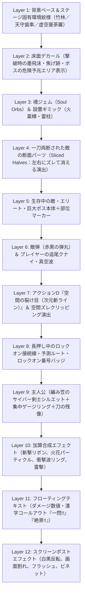
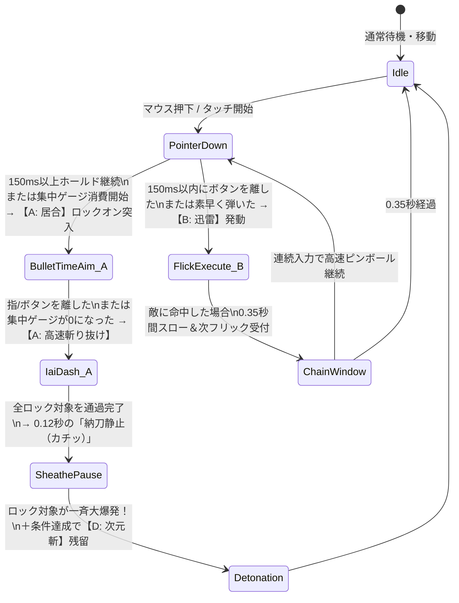

# 『CHAIN SLASH : 絶・一閃（ZETSU-ISSEN）』完全ゲームデザイン＆技術仕様書
**対象実装モデル**: Claude Opus (HTML5 / Canvas 2D / Web Audio API 実装担当)  
**ドキュメントの目的**: 本書は、実装担当AI（Claude Opus）が独自の推測や仕様の省略を一切行わず、そのままコードへ100%忠実に落とし込めるよう、ゲームメカニクス・数式・状態遷移・ビジュアル描画・UIレイアウト・音響合成アルゴリズムのすべてを厳密に定義したマスター設計書である。

---

## 0. 実装担当AI（Claude Opus）への絶対遵守ルール

> [!IMPORTANT]
> 1. **仕様の勝手な省略・変更の禁止**: 本設計書に記載されたアクション（B:迅雷、A:居合、D:次元斬）、スタイルランク3段階進化、ヴァンサバ式スキル進化（全8系統）、2段階奥義（100% / 200%）、全3幕のステージ＋ボス部位破壊＆処刑演出、エンドレスモード、4振りの刀と道場アンロックを**すべて省略せずに実装すること**。
> 2. **外部アセット依存ゼロ（100%プロシージャル生成）**: 画像ファイル（PNG/JPG等）や外部音声ファイル（MP3/WAV等）、外部フォントCDNが読み込めない環境でも完全に動作するよう、すべてのキャラクター・背景・墨飛沫・ネオン刀光は **HTML5 Canvas API のベクター＆パーティクル描画** で実装し、すべての効果音・BGMは **Web Audio API のシンセサイザー合成** で実装すること。
> 3. **60fpsの徹底維持**: パーティクルや斬撃エフェクトが画面を埋め尽くす後半でもフレームレートが低下しないよう、オブジェクトプールまたは配列のインプレース削除・上限キャップ（パーティクル最大800個、ダメージ表記最大80個）を設けること。
> 4. **マウス＆タッチの完全両対応**: PC（マウスクリック・ドラッグ＋キーボードショートカット）とスマホ／タブレット（タッチ＆スワイプ）の両方で全く同じ快適さで遊べること。
> 5. **全7ファイルの分割構成の厳守**: トークン上限によるコードの省略・手抜きを完全に防ぐため、単一ファイルに詰め込まず、下記「0.1 ファイル分割構成＆モジュール設計」の **全7ファイル構成** に厳密に従って1ファイルずつ高密度に実装すること。

### 0.1 ファイル分割構成＆モジュール間インターフェース仕様（全7ファイル）

ローカル環境で `index.html` を直接開いた場合（`file://` プロトコル）でもCORSエラーを起こさず即座に動作するよう、ES Modules（`type="module"`）やバンドラーは使用せず、**グローバル名前空間 `window.ZetsuIssen` を介した7ファイル構成** とする。

```text
/ (プロジェクトルート)
├── index.html       # [1] HTML構造・Canvas要素・全UIオーバーレイ・HUD・scriptタグ読み込み
├── style.css        # [2] サイバー墨絵×ネオン閃光テーマのCSSスタイル・UIアニメーション・レスポンシブ定義
└── js/
    ├── config.js    # [3] 定数・カラーパレット・刀4種・スキル8種＋極意進化8種・ステージ3幕・道場データ定義
    ├── audio.js     # [4] Web Audio API プロシージャル音響合成エンジン（効果音12種＋和風サイバービートBGM）
    ├── effects.js   # [5] 水墨デカール・一刀両断の断面分解（Bisection）・次元斬空間ズレ・12層Canvasレンダラー
    ├── entities.js  # [6] 主人公・雑魚敵6種・設置ギミック3種・巨大ボス3体（部位破壊ALL BREAK＆処刑演出）クラス群
    └── main.js      # [7] 入力判定(B:迅雷 / A:居合 / D:次元斬)・スタイルランク進化・奥義・ゲームループ・UI/セーブ管理
```

#### `index.html` における `<script>` 読み込み順序（厳守）
`index.html` の `</body>` 直前で、必ず以下の順序でスクリプトを読み込むこと：
```html
<script defer src="js/config.js"></script>
<script defer src="js/audio.js"></script>
<script defer src="js/effects.js"></script>
<script defer src="js/entities.js"></script>
<script defer src="js/main.js"></script>
```

#### 各ファイルの責務と公開オブジェクト（`window.ZetsuIssen`）
1. **`js/config.js` (`window.ZetsuIssen.Config`)**
   * カラーコード定義（`COLORS`）、入力・物理パラメータ（`PARAMS`）、スタイルランク閾値テーブル（`STYLE_RANKS`）、刀4種の定義データ（`BLADES`）、ベーススキル8種＆極意進化スキル8種の定義（`SKILLS`, `AWAKENINGS`）、道場6項目の強化テーブル（`DOJO_UPGRADES`）、全3幕＋EXステージのウェーブ進行テーブル（`STAGES`）をすべて定義する。
2. **`js/audio.js` (`window.ZetsuIssen.Audio`)**
   * `SoundEngine` クラスを定義。外部音源を一切使わず、`AudioContext` で以下すべてのメソッドを実装する：
     * `playLockOn(chainIndex, isBomb)`（ヨナ抜きペンタトニック音階上昇）
     * `playPinballSlash(comboCount)`（高速フリック斬撃音）
     * `playIaiStep(stepIndex, totalSteps)`（居合の高速斬り抜け音）
     * `playSheatheClick()`（納刀時の「カチッ！」金属音）
     * `playDetonation(chainCount, isBossBreak)`（同時大爆発の重低音サブベース＋和音）
     * `playVoidSlash()` / `playVoidCollapse()`（次元斬の空間裂傷音・閉鎖爆発音）
     * `playParry()`（敵弾パリィ成功の金属反響音）
     * `playGemPickup(streakIndex)`（魂ジェム吸引のクリスタルアルペジオ）
     * `playUltimate100()` / `playUltimate200()`（第壱・第弐奥義の専用演出音）
     * `startBgm(stageId)` / `setBgmIntensity(styleRank)`（スタイルランクに応じてテンポとベースラインが盛り上がるプロシージャルBGM）
3. **`js/effects.js` (`window.ZetsuIssen.Effects`)**
   * `EffectManager` および `Renderer` クラスを定義。
   * 床面の水墨飛沫デカール（`InkDecal`）、一刀両断された敵が断面で左右にズレて消えるパーツ（`SlicedHalf`）、次元斬の空間断裂ラインと画面クリッピングズレ描画（`VoidRift`）、斬撃リボン軌跡（`SlashTrail`）、火花パーティクル（`SparkParticle`）、漢字コールアウト＆ダメージポップアップ（`FloatingText`）の更新と、**第2章「2.2 Canvas 描画レイヤー順序（Layer 1〜Layer 12）」に完全準拠した描画処理** を担う。
4. **`js/entities.js` (`window.ZetsuIssen.Entities`)**
   * `Player`、通常敵6種（`SwarmSpider`, `SniperAshigaru`, `SplitterNinja`, `BombLantern`, `ArmoredOni`, `BerserkRonin`）、ステージギミック3種（`PowderBarrel`, `ThunderLantern`, `VoidCrystal`）、そして全3幕の巨大ボスクラス（`BossCentipede`, `BossSixArmGeneral`, `BossSwordSaint`）を定義。
   * ボスの弱点核（`WeakCore`）の管理、一筆書きでの全核ロックオンによる **`ALL BREAK!!`（部位全破壊・詠唱阻止・18%割合ダメージ＋4秒スタン）**、およびHP0到達時の **`EXECUTION`（2.5秒間の無制限百裂斬りトドメ演出）** を完全に実装する。
5. **`js/main.js` (`window.ZetsuIssen.Game`)**
   * ゲーム全体のステートマシン（`TITLE`, `DOJO`, `PLAYING`, `LEVEL_UP`, `BOSS_INTRO`, `BOSS_EXECUTION`, `STAGE_CLEAR`, `GAME_OVER`）、ポインター入力による **短フリック（B:迅雷）と長押し（A:居合）の140ms自動分岐ロジック**、スタイルランク連動の3段階進化、第壱・第弐奥義の発動シーケンス、`localStorage` セーブ／ロード、DOM UI更新を統括する。

---

## 1. ゲームコンセプト＆コア体験（なぜ永遠に飽きないのか）

### 1.1 タイトル
* **メインタイトル**: **『CHAIN SLASH : 絶・一閃』**
* **サブタイトル**: **CYBER-INK HYPER IAI ACTION**

### 1.2 コア・ドパり体験（3大アクションの融合）
プレイヤーは1つのシンプルなポインター操作（マウスまたは指）だけで、以下の3つの快感をシームレスに行き来する：
1. **【短フリック ＝ アクションB：迅雷（高速ピンボール連撃）】**
   * シュッ！と短く弾くだけで、狙った方向の敵へ目にも留まらぬ速さで突進斬り。
   * 敵を斬った瞬間に **0.35秒だけ時間がスロー（チェイン受付状態）** になり、テンポよく連続フリックするだけで敵から敵へピンボールのように超高速で飛び移り続ける。
2. **【長押しドラッグ ＝ アクションA：居合（時間停止・一筆書きロックオン＆納刀同時爆砕）】**
   * 画面を長押しすると **バレットタイム（時間が12%の超スロー）** に突入。
   * そのまま一筆書きで敵群や敵弾をなぞると、「カキン、カキン、カキン…！」と音階（ペンタトニックスケール）が上がりながら次々と標的をロックオン。
   * 指を離した瞬間、神速の残像を残して全員を斬り抜け、終点で **「カチッ（納刀）」と0.12秒静止した直後、斬った敵全員が同時に大爆発** する。
3. **【コンボ覚醒追加 ＝ アクションD：次元斬（空間断裂ライン）】**
   * コンボを重ねてスタイルランクが上昇すると、斬撃が通過した軌跡そのものが **「空間の裂け目（次元斬）」** として画面に残り続ける。
   * 画面の空間自体がズレて割れ、裂け目に触れた後続の敵を次々と自動切断し、空間が閉じる瞬間に画面全体へ大爆発を起こす。

---

## 2. アートディレクション＆ビジュアル仕様（『サイバー墨絵 × ネオン閃光』）

### 2.1 カラーパレット厳密定義
「漆黒の水墨画空間」をベースに、ネオンカラーの刀光と黄金の爆発が超高コントラストで映える配色とする。**紫系の曖昧なダークテーマ配色は禁止（ただし『妖刀・紫電』および雷属性エフェクトの専用色として指定されたシアン〜紅紫は除く）**。

| 用途カテゴリ | トークン名 | カラーコード (HEX / RGBA) | 描画・ブレンド指定 |
| :--- | :--- | :--- | :--- |
| **背景ベース（墨黒）** | `--bg-ink-deep` | `#07080C` | 通常時のキャンバス背景塗りつぶし |
| **バレットタイム背景** | `--bg-ink-slow` | `#030406` | 長押し（居合モード）中の背景暗転色 |
| **水墨デカール（血墨）** | `--decal-ink` | `rgba(18, 22, 32, 0.75)` | 敵撃破時に床面に残る水墨スプラッター（最大10秒でフェード） |
| **主人公・基本刀光（白夜）** | `--blade-white` | `#F8FAFC` (芯) / `#00F0FF` (外光) | `globalCompositeOperation = 'lighter'` で二重描画 |
| **紅蓮カラー（危機・二刀流）** | `--neon-crimson` | `#FF1E42` | 敵弾、重装鬼、双影・紅蓮の刀光、ダメージ警告 |
| **黄金カラー（覚醒・爆砕）** | `--neon-gold` | `#FFBE2E` | コンボ文字、爆弾樽、大太刀・断界、SSSランク演出 |
| **翡翠カラー（魂ジェム）** | `--neon-jade` | `#00E5A3` | 敵がドロップする魂（経験値ジェム）、回復エフェクト |
| **蒼雷カラー（ロックオン）** | `--neon-cyan` | `#00F0FF` | ロックオン照準、パリィ成功、雷撃チェイン |
| **空間断裂カラー（次元斬）** | `--void-slash` | `#FFFFFF` (断面線) / `#FF1E42` (亀裂縁) | 空間ズレ境界線の描画 |
| **UIパネル背景** | `--ui-panel` | `rgba(10, 12, 18, 0.88)` | 和紙・黒漆風の半透明パネル |
| **UI枠線（金継ぎ風）** | `--ui-border` | `rgba(255, 190, 46, 0.28)` | パネルやカードの1pxボーダー |

### 2.2 Canvas 描画レイヤー順序（下層から上層へ）
毎フレーム `draw()` 関数は以下の厳密な順序で描画を行うこと：



### 2.3 キャラクター・オブジェクトのプロシージャル造形仕様
単なる「塗りつぶし円（`ctx.arc` のみ）」の手抜き描画を禁止し、以下の造形ルールで描画すること：
* **主人公（サイバー浪人）**:
  * 中央に半径 `14px` の鋭角的な「編み笠（円錐を上から見た八角形＋ 방사状の笠筋）」を描画し、背後に移動方向と逆へなびく「深紅または蒼白の残像マフラー（過去8フレームの座標を繋いだテーパー付きポリゴン）」を描画する。
  * 主人公の外周（半径 `22px`）に、現在の「集中ゲージ（Focus）」を示す円弧ゲージを描画する。
* **一刀両断の断面分解（Bisection Effect）**:
  * 敵が撃破された瞬間、その敵の図形を「斬撃角度 `slashAngle`」の直線で上下（または左右）2つの半円・半多角形パーツに分割する。
  * 分割面に白い閃光線を引き、2つのパーツが斬撃線に対して垂直方向へゆっくりズレながら（`0.45秒` かけて）墨の粒子となって消滅する。

---

## 3. 入力判定＆3大アクション（B・A・D）の詳細仕様

### 3.1 入力ステートマシン（短フリック B と 長押しドラッグ A の自動判別）
プレイヤーが特別なモード切替ボタンを押す必要はなく、**1つのマウスボタン（左クリック）または1本の指のタッチ**から、以下のルールで **アクションB（迅雷）** と **アクションA（居合）** を直感的に使い分けられるようにする。



#### 厳密な入力パラメータ
* **ホールド判定閾値 (`HOLD_THRESHOLD_MS`)**: `140ms`
  * ポインター押下から `140ms` 未満で離された場合：押下位置から離した位置へのベクトル（距離が `12px` 未満なら主人公からカーソル位置へのベクトル）へ向かって **【アクションB：迅雷（高速ピンボール突進）】** を即時発動する。
  * ポインター押下から `140ms` 以上経過した場合（または押下したまま累計 `90px` 以上ドラッグし、かつ2体以上の敵に触れた場合）：即座に **【アクションA：居合（バレットタイム・一筆書きロックオン）】** へ移行する。

---

### 3.2 アクションB：『迅雷（高速ピンボール連撃）』の仕様
素早いフリック／クリックで敵から敵へ稲妻のように飛び移る高速連撃アクション。

1. **突進距離と速度**:
   * 基本突進距離：`260px`（指定方向に敵がいる場合は、最大 `320px` 以内の最も近い敵へ自動で磁気ホーミング補正を行う。角度補正は左右 `±28度` 以内）。
   * 突進速度：瞬間移動に近い超高速ダッシュ（移動時間 `0.045秒`）で、軌跡に鋭い刀光リボンを残す。
   * 突進中は完全無敵（`invuln = 0.25秒`）。
2. **ピンボール反射＆チェイン受付スロー**:
   * 突進軌道上の敵（幅 `38px` のカプセル判定）をすべて斬り裂き、基礎ダメージ `1.5 × 刀攻撃力` を与える。
   * **敵または敵弾に1つでも命中した場合**：
     * 集中ゲージ（Focus）が `+18` 回復する。
     * 命中した瞬間、**`0.35秒` 間の「チェイン受付バレットタイム（ゲーム内時間速度 `0.20倍`）」** が発生する。
     * この `0.35秒` の間に次の方向をクリック／フリックすると、クールタイム0秒で次の敵へ連続ピンボール突進が繋がる。
     * 連続でピンボール突進を繋ぐたび、突進速度と攻撃判定幅が1回につき `+8%`（最大 `+80%`）拡大し、音階が1段階ずつ上昇する。

---

### 3.3 アクションA：『居合（時間停止・一筆書きロックオン＆納刀同時爆砕）』の仕様
大量の敵群や弾幕を一網打尽にする、本作最大の脳汁アクション。

1. **バレットタイム（時間停止領域）**:
   * 長押し中は世界の時間進行倍率 `worldTimeScale` が **`0.12倍`（88%スロー）** になり、背景が深い墨黒（`#030406`）に沈み、画面四隅に水墨ビネットがかかる。
2. **集中ゲージ（Focus Gauge）の消費と「ロックオン回復」**:
   * 最大値：`100`。通常時は毎秒 `+45` 自動回復する。
   * 長押しドラッグ中、カーソル移動距離 `1px` あたり `0.045`、および経過時間 `1秒` あたり `12` の集中ゲージを消費する。
   * **重要（無限チェインの仕組み）**：一筆書きの軌跡が **新しい敵または敵弾をロックオンするたびに、集中ゲージが `+22` 即時回復** する。つまり、敵が画面にたくさんいる限り、ゲージが尽きることなく画面中の敵を **30体、50体、100体と一筆書きで繋ぎ続けられる**。
3. **ロックオン判定**:
   * カーソルの軌跡線分と敵の中心距離が `敵半径 + ロックオン半径（初期 46px）` 以内に入った瞬間、その敵に水色の標的照準（`#00F0FF` の回転菱形＋番号バッジ `#1, #2, #3...`）が付与され、ロックオン効果音が鳴る。
   * HPが2以上ある強敵（重装鬼やボス）に対しては、一筆書きの線を往復させて複数回なぞることで、1回の居合で複数回ロックオン（多重斬撃予約）が可能。
4. **高速斬り抜け ➔ 納刀（カチッ）➔ 同時大爆発の3段階演出**:
   * 指（マウス）を離した瞬間、ロックオンした順番通りに主人公が超高速（1ターゲットあたり `0.015秒〜0.03秒`）で全ての標的を斬り抜ける。
   * 斬り抜けられた敵はダメージをまだ受けず、**「白く発光して時間が完全に止まった状態（斬られ予約状態）」** になる。
   * 全ターゲットを斬り抜けた終点で：
     * **ロック数が3体以上の場合**：`0.12秒` の **「納刀ポーズ（画面完全静止＋金属音『カチッ！』＋主人公の刀が鞘に収まる白い十字閃光）」** が発生する。
     * `0.12秒` 経過した瞬間、**斬り抜けたすべての敵が1フレームで同時に大爆発（一斉断面分解＋水墨飛沫＋衝撃波＋重低音ボム）** する！

---

### 3.4 アクションD：『次元斬（空間断裂ライン）』の仕様
コンボ条件やスキル進化、大太刀装備時に発動する「空間そのものを切り裂く」上位攻撃。

1. **発生メカニズム**:
   * 発生した斬撃ライン（始点 `(x1, y1)` から終点 `(x2, y2)`）が、消えずに **「空間の裂け目（Void Rift）」** として画面上に `2.0秒〜3.5秒` 残留する。
2. **空間ズレのビジュアル表現（Canvas実装指定）**:
   * 裂け目の線分を中心に、幅 `10px` のギザギザな稲妻状の亀裂（内側 `#FFFFFF`、縁 `#FF1E42` または `#00F0FF`）を描画する。
   * 発動瞬間および閉鎖瞬間に、裂け目の線分を境界として画面の描画座標を平行方向に `±12px` ズラしてクリッピング描画し、**「画面の空間自体がスパッと切断されてズレた」視覚効果** を与える。
3. **持続切断＆空間閉鎖爆破**:
   * 裂け目が残留している間、`0.2秒` ごとに裂け目に触れている全ての敵へ `0.6 × 刀攻撃力` の持続切断ダメージを与え、敵弾をすべて消去する。
   * 持続時間が終了する瞬間、裂け目が「バチン！！」と収束して閉じ、ライン上の全範囲（幅 `90px`）に `2.5 × 刀攻撃力` の **空間閉鎖爆発** を起こす。

---

### 3.5 弾斬り（パリィ＆追尾クナイ変換）システム
* 敵が発射する「深紅の敵弾（半径 `7px`）」は、アクションB（迅雷）またはアクションA（居合）で斬り裂くことができる。
* 敵弾を1発斬るごとに：
  1. コンボ数が `+2 HIT` 加算される。
  2. 斬った敵弾が **「プレイヤーの蒼白い追尾クナイ（Homing Kunai）」** に変化し、最も近い敵へ向かって秒速 `620px` で自動追尾して突き刺さる（1発あたり `1.0 × 刀攻撃力` ダメージ）。

---

## 4. 条件付き攻撃進化システム①：スタイルランク連動・3段階リアルタイム進化

戦闘中、敵へのヒットや撃破を重ねることでコンボ数（CHAIN）が増加し、画面右上の **スタイルランク** がリアルタイムに上昇する。ランクに応じて主人公の攻撃性能が **【通常 Phase 1】➔【覚醒 Phase 2】➔【極限 Phase 3】** の3段階で劇的に進化する。

### 4.1 スタイルランク定義とコンボ維持タイマー

| ランク表記 | ランク名称 | 必要コンボ数 (CHAIN) | 進化フェーズ | コンボ維持猶予時間 | スコア＆魂ドロップ倍率 |
| :--- | :--- | :--- | :--- | :--- | :--- |
| **RANK C** | 抜刀 (BATTO) | 0 〜 9 HIT | **Phase 1：通常** | 4.5秒 | × 1.0 |
| **RANK B** | 疾風 (SHIPPU) | 10 〜 24 HIT | **Phase 1：通常** | 4.2秒 | × 1.5 |
| **RANK A** | 閃光 (SENKO) | 25 〜 49 HIT | **Phase 2：覚醒** | 3.8秒 | × 2.2 |
| **RANK S** | 修羅 (SHURA) | 50 〜 99 HIT | **Phase 2：覚醒** | 3.5秒 | × 3.5 |
| **RANK SS** | 夜叉 (YASHA) | 100 〜 199 HIT | **Phase 3：極限** | 3.2秒 | × 5.0 |
| **RANK SSS** | **鬼神 (KISHIN)** | **200 HIT 以上** | **Phase 3：極限** | **3.0秒** | **× 8.0** |

* **コンボ維持ルール**:
  * 長押し中（居合ロックオン中）および斬り抜けダッシュ中、ボス登場演出中は **コンボ維持タイマーの減少を完全に一時停止** する。
  * 被弾した場合、コンボ数は0にはならず **現在のコンボ数が半減（50%カット）** される（1ミスで全てを失う理不尽さを防ぎつつ、ノーダメージ維持の価値を高める）。

### 4.2 3段階フェーズ別の攻撃進化詳細テーブル

| 進化段階 | 短フリック【B：迅雷】の挙動変化 | 長押しドラッグ【A：居合】の挙動変化 | 【D：次元斬】の自動発動挙動 |
| :--- | :--- | :--- | :--- |
| **Phase 1：通常**<br>(Rank C 〜 B)<br>0〜24 HIT | ・単発の高速ピンボール突進斬り<br>・敵命中時に0.35秒のチェイン受付スロー発生 | ・時間88%スローで一筆書きロックオン<br>・離すと全員を斬り抜け、3体以上で納刀同時爆砕 | ・まだ自動発動しない（大太刀装備時またはスキル取得時のみ発生） |
| **Phase 2：覚醒**<br>(Rank A 〜 S)<br>25〜99 HIT | ・突進速度＆判定幅 **1.4倍**<br>・敵に命中するたび、着弾点に半径 `75px` の **『衝撃波リング』** が発生し周囲の敵もまとめて斬る | ・ロックオン半径 **1.35倍**、集中ゲージ回復量 **1.25倍**<br>・納刀爆発の範囲と威力が **1.5倍** に拡大 | ・5体以上を巻き込んだ居合（A）の納刀時、始点と終点を結ぶ **極太の『次元斬ライン（D）』が1本自動生成** され2秒間残留する |
| **Phase 3：極限**<br>(Rank SS 〜 SSS)<br>100 HIT〜 | ・主人公の背後に **2体の紅蓮残像（分身）** が常時追従し、1回のフリックで **3連撃（ダメージ3倍・ヒット数3倍）** になる | ・長押し中の **集中ゲージ消費が50%軽減（SSS時は消費ゼロ！）**<br>・納刀と同時に画面全体が揺れる大爆砕が発生 | ・居合（A）で描いた **一筆書きの軌跡すべてが『空間の裂け目（次元斬 D）』に変化** し、さらにピンボール（B）の3連撃ごとにもミニ次元斬が発生する無双状態 |

---

## 5. 条件付き攻撃進化システム②：ローグライト・スキル＆ヴァンサバ式『極意進化』

敵を倒すとドロップする翡翠色の **『魂ジェム（Soul Gem）』** を回収すると画面左上の経験値（XP）ゲージが増加し、満タンになるごとにレベルアップして **3択のスキル習得・強化** が発生する。

### 5.1 レベルアップ必要XP計算式
* `必要XP(Lv) = Math.floor(8 + (Lv - 1) * 6 + Math.pow(Lv - 1, 1.45) * 2)`
  * Lv1→2 は `8 XP`（開始15秒で最初のレベルアップが発生するテンポ設計）。

### 5.2 全8系統のスキル＆『LvMAX 極意進化（Awakening）』一覧
各ベーススキルは **最大 Lv5** まで強化可能。**特定のベーススキルを Lv5（MAX）にした状態で、対応する「進化条件（相棒スキル所持 または コンボ条件達成）」を満たすと、次のレベルアップ選択肢に黄金色に輝く『極意進化（Awakening）スキル』が確定枠として出現** し、攻撃が別次元へ変化する。

| # | ベーススキル名 (Lv1〜Lv5) | ベース効果（Lv1 ➔ Lv5） | 『極意進化』解放条件 | 極意進化スキル名＆ド派手な進化効果 |
| :--- | :--- | :--- | :--- | :--- |
| **1** | **二天一流・影打**<br>*(Shadow Clone)* | 斬撃時に遅れて追撃する影分身を発生させる（分身数 1体 ➔ 3体、追撃ダメージ 40% ➔ 100%） | 『二天一流・影打』Lv5<br>＋『神速の足捌き』Lv1以上 | **【極意】千手観音・無間連斬**<br>分身が常時5体に増加し、プレイヤーが斬った敵に対して分身が八方から自動で乱舞斬りを浴びせ続ける。 |
| **2** | **雷鳴抜刀**<br>*(Chain Lightning)* | 敵を斬った際、近くの敵へ紫電が連鎖する（連鎖数 2体 ➔ 6体、雷ダメージ 60% ➔ 150%） | 『雷鳴抜刀』Lv5<br>＋『居合の極意』Lv1以上 | **【極意】建御雷・天罰落雷**<br>居合（A）でロックオンした全ての敵の頭上に巨大な黄金の雷柱が落ち、画面内のロックしていない敵まで電撃ネットで一斉感電させる。 |
| **3** | **居合の極意**<br>*(Wide Iai)* | ロックオン半径 +20%〜+100% 拡大、ロック時の集中ゲージ回復量 +15%〜+75% 増加 | 『居合の極意』Lv5<br>＋『紅蓮爆砕』Lv1以上 | **【極意】森羅万象・全天ロック**<br>長押し開始と同時に画面内の半径 `280px` 以内の敵を自動で一斉ロックオンし、納刀時の爆発ダメージが2.5倍になる。 |
| **4** | **真空三日月波**<br>*(Crescent Wave)* | フリック（B）および居合（A）の終点から貫通する真空刃を放つ（発射数 1発 ➔ 5発、サイズ拡大） | 『真空三日月波』Lv5<br>＋『虚空の裂け目』Lv1以上 | **【極意】天叢雲・大車輪**<br>放たれた真空波が画面端で反射して3秒間ブーメランのように画面中を旋回し続け、通過軌跡にミニ次元斬（D）を残す。 |
| **5** | **弾返しの達人**<br>*(Parry Master)* | 敵弾を斬った際に出る追尾クナイの本数増加（2本 ➔ 6本）＋敵を10体斬るごとに追尾クナイを自動発射 | 『弾返しの達人』Lv5<br>＋ 累計30発以上の敵弾パリィ達成 | **【極意】八咫鏡・千本クナイ陣**<br>プレイヤーの周囲に常時8本の回転光刃が展開して触れた敵弾を全自動でパリィし、画面中に毎秒大量の追尾クナイをばら撒く。 |
| **6** | **紅蓮爆砕**<br>*(Crimson Nova)* | 納刀爆発およびピンボール衝撃波の半径が +25%〜+125% 拡大し、爆発が周囲の敵を誘爆する | 『紅蓮爆砕』Lv5<br>＋ 1回の居合で15体以上同時撃破を達成 | **【極意】迦具土・連鎖超新星**<br>爆砕で倒れた敵の死体がすべて「新たな連鎖爆弾」に変化し、画面端から端までドミノ倒しのように大誘爆が連鎖し続ける。 |
| **7** | **虚空の裂け目**<br>*(Void Rift)* | すべての攻撃で20%〜100%の確率で画面に『次元斬（D）』の裂け目を1.5秒〜3.5秒残す | 『虚空の裂け目』Lv5<br>＋ スタイルランク SS 以上に到達経験あり | **【極意】次元崩壊・黒縄地獄**<br>次元斬（D）の裂け目が敵を吸い寄せる重力場を持ち、裂け目が交差した地点にミニブラックホールが発生して敵を粉砕する。 |
| **8** | **神速の足捌き**<br>*(Godspeed)* | ピンボール（B）の突進距離 +20%〜+80%、集中ゲージ自然回復速度 +30%〜+150%、魂吸引範囲拡大 | 『神速の足捌き』Lv5<br>＋『二天一流・影打』Lv1以上 | **【極意】縮地・光速残像陣**<br>移動および突進の軌跡に3秒間燃え続ける「蒼炎の残像ライン」が残り、ピンボール突進時に敵を自動で次々ホーミング連鎖する。 |

---

## 6. 二段構えのゲージ必殺技（奥義システム：100% ＆ 200% OVERCHARGE）

画面下部中央（または左上の専用ゲージ）に **『奥義ゲージ（0% 〜 200%）』** を配置する。
* **ゲージ蓄積率**:
  * 敵1体撃破ごとに `+1.8%`（エリート敵は `+8%`、ボスの部位破壊は `+25%`）
  * 敵弾パリィ1発ごとに `+2.5%`
  * スタイルランク S 以上の時はゲージ上昇量が `1.5倍`

### 6.1 第壱奥義（100%〜199%で発動可能）：『千本桜・墨嵐（せんぼんざくら・すみあらし）』
* **発動操作**: 奥義ゲージ100%以上の時に **スペースキー / 右クリック / 画面下の『奥義発動』ボタン** を押す。
* **ゲージ消費**: `100%` 消費。
* **演出と効果（持続 `3.2秒`）**:
  1. 発動瞬間、画面全体が **「白黒反転（背景が和紙のような白 `#F3F4F6`、敵と墨飛沫が漆黒 `#090A0F`、刀光だけが鮮血の深紅 `#FF1E42`）」** に切り替わり、プレイヤーは完全無敵になる。
  2. `3.2秒` の間、画面のどこをなぞっても（クリック不要でカーソルを動かすだけでも）、カーソル軌跡に沿って **毎秒30本の極太『次元斬（D）』** が画面中を切り裂き続ける。
  3. `3.2秒` 終了と同時に「パリン！！」とガラス・空間が砕け散る演出が入り、画面内の全敵に `15 × 刀攻撃力` の全体フィニッシュダメージを与える。

### 6.2 第弐奥義（200% OVERCHARGEで発動可能）：『絶・虚空一文字（ぜつ・こくういちもんじ）』
100%で温存し、ゲージを **200%（MAX OVERCHARGE）** まで溜め切って発動する究極の脳汁必殺技。
* **ゲージ消費**: `200%` 全消費。
* **3フェーズのインタラクティブ演出**:
  1. **Phase 1：重力収束（`1.2秒`）**
     * 画面中央に巨大な「漆黒の太陽（金色の日食リングを伴うブラックホール）」が出現。
     * 画面内のすべての雑魚敵・エリート敵・敵弾・魂ジェムが、重低音の吸引音とともに画面中央の1点へ強制的にギュイーンと吸い寄せられて団子状に密集する（ボスも中央へ引き寄せられ行動不能になる）。
  2. **Phase 2：一文字スワイプ受付（最大 `1.5秒` の完全時間停止）**
     * 画面中央を貫く黄金のガイドラインと **『一閃せよ！！（SWIPE ACROSS!!）』** の巨大書道カットインが表示される。
     * プレイヤーが画面をスパッと横切るようにスワイプ（またはクリック）した瞬間（1.5秒経過時は自動発動）、Phase 3へ移行。
  3. **Phase 3：空間二分割＆超新星爆砕**
     * 画面全体が中央の斬撃線で上下2つにガクッと大きくズレ（画面二分割演出）、一拍（`0.18秒`）の静寂ののち、中央に集められた敵全員が **黄金と深紅の超新星爆発（ダメージ `50 × 刀攻撃力`、雑魚・エリートは確定即死、ボスにも特大ダメージ＋確定スタン）** を起こし、画面中から数百個の魂ジェムが噴水のように吹き出す！

---

## 7. 全3幕ステージ構成・敵キャラクター・巨大ボス＆クリア後エンドレス設計

### 7.1 全3幕のステージ進行構成
各ステージは「規定時間のウェーブサバイバル」＋「時間到達時に出現する幕末ボス撃破」でクリアとなる。

| ステージ | 舞台テーマ・背景ビジュアル | サバイバル時間 | 登場する固有ギミック | ステージボス |
| :--- | :--- | :--- | :--- | :--- |
| **第1幕** | **『竹林サイバー城下町』**<br>深い藍墨色の背景に、風に揺れる発光竹林のシルエットと石畳の格子紋様 | **3分00秒**<br>(180秒) | **【火薬樽】**<br>斬ると周囲半径 `120px` を大誘爆し、近くの敵も自動ロックオンする | **『からくり大百足・黒鉄』**<br>*(Mecha-Centipede KUROGANE)* |
| **第2幕** | **『紅蓮の機械天守閣』**<br>黒赤色の背景に、ゆっくり回転する巨大な黄金の歯車紋様と火の粉パーティクル | **4分00秒**<br>(240秒) | **【火薬樽】＋【紫電灯籠】**<br>灯籠を斬ると周囲の敵5体に連鎖雷撃が走り3秒間麻痺させる | **『六腕の重装鬼将・獄炎』**<br>*(Six-Armed General GOKUEN)* |
| **最終幕** | **『虚空の異界・白夜城』**<br>漆黒の宇宙空間に浮かぶ白銀の鳥居シルエットと幾何学曼荼羅リング | **5分00秒**<br>(300秒) | **【虚空水晶】**<br>斬ると周囲に3秒間『次元斬（D）』の十字裂け目を発生させる | **『次元喰らいの剣聖・無明』**<br>*(Void Sword Saint MUMYO)* |
| **EX幕**<br>*(解放要素)* | **『無限エンドレス：修羅・無間獄』**<br>第3幕クリアで解放。時間経過とともに背景が白夜➔紅蓮➔黄金へと変化し続ける | **時間無制限**<br>(無限耐久) | 全ギミックが出現。90秒ごとにボスがランダム（強化版）で乱入し続ける | 90秒ごとに歴代ボスが複数部位強化されて再登場 |

---

### 7.2 通常敵（雑魚＆エリート全6種）のパラメータと挙動

| 敵名称 | 見た目・形状（Canvas造形） | 半径 | 基礎HP | 移動速度 | 挙動・ドパり役割 |
| :--- | :--- | :--- | :--- | :--- | :--- |
| **1. 笠蜘蛛（群れ雑魚）** | 赤い三つ目紋様を持つ黒塗りの小型六角形ドローン | `14px` | `1` | `95 px/s` | 常に8〜16体の密集陣形（S字や円陣）で湧き、**一筆書き（A）やピンボール（B）の気持ちいいコンボ燃料**になる。 |
| **2. 鉄砲足軽（狙撃手）** | 橙色の菱形シルエット＋プレイヤーへ向く赤い照準レーザー線 | `16px` | `1` | `60 px/s` | 一定距離で立ち止まり、赤い照準線の後に「斬れる赤弾」を3連射する。**弾斬りパリィの供給源**。 |
| **3. 幻影忍（分裂妖）** | シアン色に発光する手裏剣型の高速忍 | `18px` | `1` | `110 px/s` | 斬られるとその場で **3体の小型分身（HP1）に分裂** する。次のチェインがさらに伸びるボーナス敵。 |
| **4. 提灯お化け（自爆誘爆）** | 黄金に脈動する提灯型オーブ（中央に『爆』の文字） | `20px` | `1` | `55 px/s` | 一筆書き（A）でロックオンした瞬間、周囲半径 `130px` の敵を**自動でチェインに巻き込み**、撃破時に大誘爆を起こす。 |
| **5. 重装鬼（装甲エリート）** | 深紅の鬼面紋様を持つ大型八角形＋白い装甲リング | `26px` | `4` | `52 px/s` | タフな中型敵。一筆書きの線を往復させて4回ロックオンするか、高ランクの次元斬で一気に削り切る快感を生む。 |
| **6. 狂刃浪人（高速エリート）** | 第2幕以降に登場。紫の残像を纏う中型の剣士 | `20px` | `3` | `135 px/s` | 突進前に0.6秒間「赤い抜刀予兆ライン」を表示してから高速突進する。予兆中に先に斬ると **『カウンター一閃（ダメージ3倍＋魂5倍）』** が発生する。 |

---

### 7.3 巨大ボス3体の設計＆『部位一筆書き全破壊（ALL BREAK）』＆『処刑（EXECUTION）』ギミック

各ステージのサバイバル時間が終了すると、画面上の雑魚が一掃され、`WARNING — 強敵出現` の水墨カットインとともに巨大ボスが登場する。

#### ボス戦共通の2大ドパりギミック（必須実装）
1. **『弱点部位（Weak Core）一筆書きロックオン全破壊（ALL BREAK!!）』**:
   * ボスは本体の他に、複数の **『弱点核（黄金に光る部位マーカー）』** を展開する。
   * 長押し居合（A）の一筆書き1回のストローク中に、**ボスのすべての弱点核を繋いでロックオンし、納刀爆発を決めると『ALL BREAK!!（部位全破壊）』が発生！**
   * ALL BREAK が決まると：
     * ボスの大技詠唱が強制キャンセルされ、ボスに **最大HPの18%の固定割合ダメージ** が入る。
     * ボスが `4.0秒` 間「大ダウン（防御力半減・完全無防備）」になり、大量の魂ジェムと奥義ゲージ `+40%` が噴き出す！
2. **『処刑フィニッシュ（EXECUTION：絶・居合トドメ演出）』**:
   * ボスのHPが残り `0` になった瞬間、ボスはすぐには消えず、画面中央で膝をつき（または動きを止め）、周囲の時間が完全停止して **『トドメを刺せ！！（FINISH HIM!!）』** の赤黒カットインが入る。
   * `2.5秒` 間、ボスに対して無制限にフリック＆スワイプで百裂斬りを叩き込めるボーナスタイムが発生し、最後にプレイヤーが指を離すと **極太の黄金一閃＋納刀カチッ➔ボスが巨大な水墨と黄金の粒子となって大爆散** し、ステージクリアとなる！

#### ボス個別の仕様
* **第1幕ボス：『からくり大百足・黒鉄（KUROGANE）』**
  * **造形**: 8個の装甲節（半径 `28px` の連結多角形）がうねりながら画面を縦横無尽に這い回る巨大ムカデ。
  * **弱点核**: 頭部・第3節・第6節・尾部の **計4箇所**。ムカデの胴体に沿ってS字に一筆書きでなぞると4箇所すべてを気持ちよく一気ロックオンできる！
  * **攻撃パターン**: ①胴体からの全方位赤弾ばら撒き（一筆書きで弾ごと全部斬れる）、②赤い突進予兆ラインからの画面横断チャージ。
* **第2幕ボス：『六腕の重装鬼将・獄炎（GOKUEN）』**
  * **造形**: 画面中央に鎮座する半径 `52px` の巨大武者ボディの周囲に、6本の独立した「浮遊からくり鬼腕（大刀や大砲を持つ腕）」が回転している。
  * **弱点核**: 周囲を回る **6本の鬼腕すべて（計6箇所）**。ボスの周りをぐるっと円を描くように一筆書きすると6本全部を一気にロックオンして『ALL BREAK!!』できる。
  * **攻撃パターン**: ①火炎弾の螺旋連射、②床面への巨大赤円予兆からの叩きつけ衝撃波。
* **最終幕ボス：『次元喰らいの剣聖・無明（MUMYO）』**
  * **造形**: 白銀と漆黒の羽衣を纏った人型剣聖（半径 `34px`）で、周囲に **5つの『虚空の鏡（浮遊ビット）』** を展開している。
  * **弱点核**: 5つの虚空の鏡＋無明本体の **計6箇所**。
  * **攻撃パターン**: ①画面に赤い「敵版・次元斬予兆ライン」を3本引き、1.2秒後に空間ごと斬り裂く（発動前に無明本体または鏡をALL BREAKすると阻止可能）、②分身4体を召喚しての一斉居合構え（本物と分身をまとめて一筆書きで斬り伏せると特大カウンター！）。

---

## 8. 永続アンロック・育成要素（拠点『鍛冶場・道場』）

ステージクリア時またはゲームオーバー時に、そのランのスコアと撃破数から永続通貨 **『魂貨（Soul Coin / 単位：両）』** を獲得する。
* **獲得魂貨計算式**: `獲得魂貨 = Math.floor(スコア / 250) + (撃破数 * 2) + (ボス撃破数 * 300)`

タイトル画面から遷移できる **『鍛冶場・道場（ARMORY & DOJO）』** で、以下の「4振りの刀」と「6種の道場基礎鍛錬」を永続解放・強化できる。

### 8.1 4振りの刀（武器選択＆アンロック）

| 刀名称 | 解放コスト | 刀光カラー | 固有プレイスタイル＆特殊性能 |
| :--- | :--- | :--- | :--- |
| **1. 無銘・白夜**<br>*(Byakuya)* | 初期装備<br>(0両) | 蒼白 (`#00F0FF`) | **【標準バランス型】**<br>基礎攻撃力 `1.0`、初期HP `4`、ロックオン半径 `46px`。すべてのアクションが高水準で使いやすい王道の一振り。 |
| **2. 双影・紅蓮**<br>*(Guren Twin Blades)* | `800両` | 深紅 (`#FF1E42`) | **【アクションB（ピンボール高速連撃）特化・二刀流】**<br>基礎攻撃力 `0.75 × 2回ヒット`、初期HP `4`。短フリック（B）の突進距離が `+35%` 伸び、最初からすべての斬撃が **2連ヒット（コンボ数が2倍の速さで溜まる！）** する。 |
| **3. 大太刀・断界**<br>*(Dankai Great Katana)* | `1,800両` | 黄金 (`#FFBE2E`) | **【アクションD（次元斬・空間破壊）特化】**<br>基礎攻撃力 `1.6`、初期HP `5`。斬撃幅が2倍に太くなり、**スタイルランクに関わらず最初からすべての居合（A）と3連ピンボール（B）の軌跡に『次元斬（D）』の空間裂け目が発生** する。 |
| **4. 妖刀・紫電**<br>*(Shiden Cursed Blade)* | `3,200両` | 紫電 (`#D946EF` / `#00F0FF`) | **【アクションA（無限一筆書き）特化・超火力】**<br>基礎攻撃力 `1.4`、初期HP `3`（やや打たれ弱い）。長押し中の **集中ゲージ消費が最初から40%軽減** され、最初から『雷鳴抜刀 Lv1』を所持した状態でスタートする。さらに100チェイン達成ごとにHPが1自動回復する。 |

### 8.2 道場・永続ステータス強化（全6項目、各最大 Lv5）
1. **【心眼（ロックオン間合い）】**: ロックオン半径が1レベルにつき `+8%` 拡大（最大 `+40%`）。
2. **【気合（最大集中力）】**: 集中ゲージ最大値と自然回復速度が1レベルにつき `+10%` 増加（最大 `+50%`）。
3. **【剛剣（基礎攻撃力）】**: すべての斬撃・爆発ダメージが1レベルにつき `+12%` 増加（最大 `+60%`）。
4. **【金剛（初期シールド）】**: 初期最大HPが1レベルにつき `+1` 増加（最大 `+5`、初期4と合わせて最大9）。
5. **【吸魂（成長加速）】**: 魂ジェムの吸引範囲と獲得XPが1レベルにつき `+15%` 増加（最大 `+75%`）。
6. **【鬼脈（奥義充填）】**: ステージ開始時の初期奥義ゲージが1レベルにつき `+20%` 増加（Lv5なら開幕から100%奥義が即撃てる！）。
* **各レベルの強化コスト**: `Lv1: 150両`, `Lv2: 350両`, `Lv3: 700両`, `Lv4: 1,300両`, `Lv5: 2,200両`

### 8.3 セーブデータ (`localStorage`) スキーマ定義
キー名: `zetsu_issen_save_v1`
```json
{
  "soulCoins": 0,
  "highScore": 0,
  "maxChainRecord": 0,
  "clearedStages": [false, false, false],
  "unlockedBlades": ["byakuya"],
  "selectedBlade": "byakuya",
  "dojoLevels": {
    "lockRadius": 0,
    "focusMax": 0,
    "attackPower": 0,
    "maxHp": 0,
    "xpGain": 0,
    "startingUlt": 0
  }
}
```

---

## 9. 脳汁演出（Juice / Game Feel）＆ Web Audio API 音響仕様

### 9.1 視覚的ヒット感（Juice パラメータ）
1. **ヒットストップ（Hitstop）**:
   * ピンボール突進（B）命中時：`25ms` の瞬間フリーズ。
   * 居合（A）の納刀同時爆砕時：`Math.min(110, 35 + ロック数 * 4) ms` の重量感あるフリーズ。
   * ボス部位全破壊（ALL BREAK）および第弐奥義爆砕時：`160ms` の劇的フリーズ。
2. **ダイナミック・カメラズーム＆画面シェイク**:
   * 長押し（居合ロックオン）中はカメラを `1.0 ➔ 1.04` へ滑らかにズームインして集中感を高める。
   * 納刀爆発の瞬間にカメラを `1.08〜1.14` へ瞬間パンチズームし、`0.25秒` かけて `1.0` に戻す。
   * シェイク量は減衰式 `shake *= Math.pow(0.05, dt)` で滑らかに収束させ、最大振幅は `26px` とする。
3. **漢字コールアウト演出**:
   * 同時撃破数やアクションに応じて、毛筆・極太ゴシック調のコールアウト文字が画面にポップアップする：
     * 3〜5体同時爆砕：**『一閃!!』**（`#00F0FF`）
     * 6〜11体同時爆砕：**『神速連斬!!』**（`#FFBE2E`）
     * 12〜24体同時爆砕：**『無双絶景!!』**（`#FF1E42`）
     * 25体以上同時爆砕：**『天衣無縫・極一閃!!』**（黄金虹色発光）
     * 敵弾パリィ時：**『弾斬り!』**（`#00F0FF`）
     * 次元斬閉鎖時：**『空間断裂!!』**（`#FFFFFF`）

### 9.2 Web Audio API プロシージャル音響合成仕様
すべてのサウンドは `AudioContext` を用いてリアルタイム合成する（ミュート切替ボタンも常設）。

1. **ロックオン音階上昇（Pitch Ramp）**:
   * 1回のチェイン（または連続ピンボール）でターゲットをロック／斬るたび、基準周波数 `523.25Hz (C5)` から以下の和風ヨナ抜きペンタトニック音階（半音オフセット配列）に従ってピッチを上昇させる：
     * `semitones = [0, 2, 4, 7, 9, 12, 14, 16, 19, 21, 24, 26, 28, 31, 33, 36, 38, 40]`
     * 19体目以降は1体ごとにさらに `+0.5半音` ずつ上限なく高音へ突き抜ける設定とし、30チェイン以上繋いだ時に脳が痺れるような高周波クリスタルチャイムを鳴らす。
2. **納刀クリック音（「カチッ…！」）**:
   * 同時爆砕の `0.12秒` 前に、`2600Hz ➔ 720Hz`（`0.04秒`）の矩形波（`square`）＋ハイパスノイズで、日本刀の鍔（つば）が鞘に鳴る鋭い金属音を鳴らす。
3. **同時爆砕ボム音（「ズバァァン！！」**:
   * サブベース（`sine` 波 `140Hz ➔ 28Hz`、`0.42秒`）＋ホワイトノイズのローパスフィルタースイープ＋チェイン数に応じたパワーコード和音（`[523.25, 659.25, 783.99, 1046.5] Hz`）を重ねて鳴らす。
4. **魂ジェム吸引音**:
   * ジェムがプレイヤーに吸い込まれるたび、連続回収数に応じてピッチが階段状に上がる短いサイン波チャイム（`880Hz` 基準、`0.05秒`）を高速連打で鳴らす。

---

## 10. UIレイアウト＆画面遷移ワイヤーフレーム

### 10.1 画面遷移構成
1. **タイトル＆ステージ選択画面**:
   * ゲームタイトルロゴ、ハイスコア・最大チェイン記録表示。
   * **ステージ選択カード**: 『第1幕：竹林サイバー城下町』『第2幕：紅蓮の機械天守閣』『最終幕：虚空の異界』『無限エンドレス：修羅・無間獄（クリア後解放）』。
   * **『鍛冶場・道場（刀変更・永続強化）』ボタン**（現在の所持魂貨を表示）。
2. **鍛冶場・道場モーダル**:
   * 上段：4振りの刀の選択・解放カード（刀光プレビュー色・固有性能表示）。
   * 下段：6項目の道場鍛錬アップグレードボタン（現在Lv、効果値、必要魂貨）。
3. **インゲームHUD配置**:
   * **左上**: スコア、現在のレベル＆XPバー、HPシールドピップ（斜め平行四辺形ピップ）、現在の奥義ゲージ（0%〜200%、100%到達で発光、200%到達で黄金炎エフェクト）。
   * **中央上**: 現在のステージ名、残りサバイバル時間タイマー（`03:00` カウントダウン。ボス戦突入時は **ボスの巨大HPバー＋残存弱点核アイコン** に切り替わる）、音量ON/OFFボタン、ポーズ/リトライボタン。
   * **右上**: **スタイルランクバッジ（`C / B / A / S / SS / SSS 鬼神`）**、巨大コンボカウンター（`999 CHAIN`）、コンボ維持タイマーバー、現在発動中の進化フェーズ表示（`通常 / 覚醒 / 極限・次元斬`）。
   * **左下**: 習得済みスキル＆極意進化スキルのアイコン・レベル一覧バッジ。
   * **中央下**: 奥義ゲージが100%以上の時、クリック／タップでも発動できる **『奥義発動（SPACE / 右クリック）』ボタン** を大きく表示。
4. **レベルアップ・スキル選択モーダル**:
   * ゲーム時間を完全一時停止し、3枚の和風スキルカードを横並び表示（数字キー `1 / 2 / 3` またはクリックで即座に選択可能）。
   * 『極意進化（Awakening）』が出現した際は、カード枠を黄金の稲妻エフェクトで強調表示する。
5. **リザルト画面（ステージクリア / ゲームオーバー）**:
   * 最終スコア、最大チェイン数、撃破数、到達スタイルランク、**今回獲得した魂貨（＋内訳）** をアニメーション表示。
   * 『次の幕へ進む』『鍛冶場・道場で強化する』『もう一度斬る（即リトライ）』の3ボタンを配置。

---

## 11. 実装チェックリスト（Claude Opus 自己検証用）

実装完了前に、以下の項目がすべて満たされているか必ずコードを確認すること：
- [ ] 短フリックで **アクションB（迅雷：ピンボール連撃＋0.35秒チェインスロー）**、長押しドラッグで **アクションA（居合：時間停止一筆書き＋納刀同時爆砕）** が両方とも快適に発動するか？
- [ ] コンボ数（スタイルランク C〜SSS）に応じて、**Phase 1（通常）➔ Phase 2（覚醒）➔ Phase 3（極限・次元斬 D）** の3段階進化がリアルタイムに機能しているか？
- [ ] レベルアップのベーススキル全8種と、Lv5到達＋条件達成で出現する **『ヴァンサバ式・極意進化スキル（全8種）』** がすべて実装されているか？
- [ ] 奥義ゲージの **100%発動『千本桜・墨嵐（白黒反転＋無制限次元斬）』** と **200%発動『絶・虚空一文字（ブラックホール吸引＋一文字二分割爆砕）』** の両方が実装されているか？
- [ ] **全3幕のステージ** と **3体の固有ボス**、およびボスの **『弱点核一筆書き全破壊（ALL BREAK!!）』** と **『トドメ処刑演出（EXECUTION）』**、さらにクリア後の **『無限エンドレスモード』** が実装されているか？
- [ ] **『鍛冶場・道場』** での4振りの刀の解放・切替と、6項目のステータス永続強化、および `localStorage` へのセーブ・ロードが動作するか？
