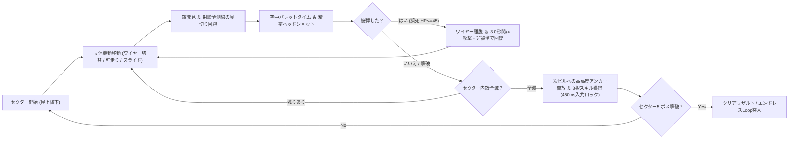
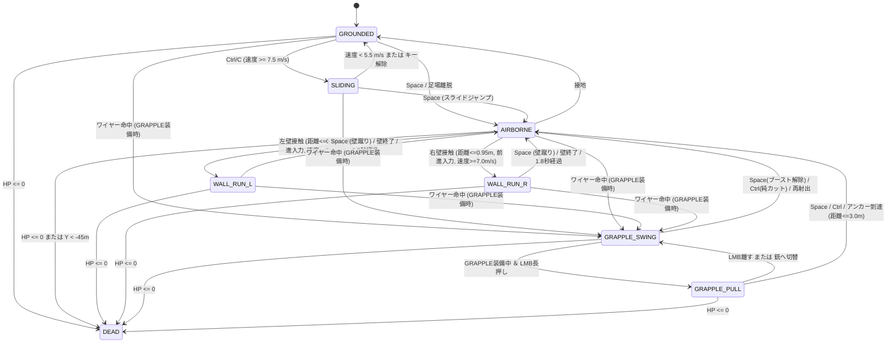

# 『STRAND // PROTOCOL』完全ゲームデザイン＆技術仕様書 (v1.0)

**対象実装担当**: Claude (TypeScript / Three.js / WebGL2 / Web Audio API 実装担当)  
**ジャンル**: 雨夜の超高層都市・ハードコア3D立体機動FPS × セクター進行ローグライト  
**ドキュメントの目的**: 本書は、実装担当AIが独自の推測・仕様省略・簡略化を一切行わず、そのままハイクオリティな製品レベルへ実装できるよう、ゲームメカニクス・物理数式・ステートマシン・3D描画＆シェーダー仕様・人型リグ＆AI・Web Audio API音響合成・全パラメータ表・ファイル構成・パフォーマンス上限を完全に定義したマスター設計書である。

---

## 0. 実装担当AIへの絶対遵守事項（Non-Negotiable Rules）

> [!CAUTION]
> 以下の8項目は本ゲームの核となる絶対要件であり、1つたりとも省略・簡略化・勝手な緩和を行わないこと。
> 1. **武器とワイヤーの排他切替仕様（同時射出不可・ぶら下がり中切替は可）**: 銃器（ピストル／SMG／ショットガン）を構えている間は新たなワイヤー射出を禁止する。ワイヤーを撃つには必ず装備をグラップルランチャーへ切り替えること。ただし、**ワイヤーをアンカーへ接続してぶら下がり・スイングしている最中に銃器へ切り替えて射撃することは可能**とし、ぶら下がり状態はそのまま維持される。
> 2. **銃を扱う全敵の「射撃直前予測線（テレグラフ・ライン）」**: 射撃を行う全エネミー（人型・ドローン・ボス）は、発射前に必ずレーザー予測線を照射し、発射直前の指定時間（`180ms〜320ms`）は照準座標を固定して高速点滅・警告音を発すること。
> 3. **超ハードコア耐久＆「非交戦リジェネ」**: プレイヤーHPは `100`。通常弾 `55`（2発で死亡）、スナイパー弾 `100`（1発即死）。ただし、**最後に攻撃（発砲）した時刻と最後に被弾した時刻の両方から `3000ms`（3.0秒）経過するまで回復を開始しない**。発砲または被弾の瞬間にタイマーをリセットする。死亡からセクター再スタートは `500ms` 以内で完結させること。
> 4. **ノーアシスト・完全手動エイム＋空中バレットタイム**: 射撃に対するエイムアシスト・オートロック・弾道補正は一切実装しない（完全実力主義）。代わりに**空中状態のみ右クリック長押しで `0.25x` スローになるバレットタイム**を実装し、ゲージはヘッドショットや空中キルで回復する設計とする。
> 5. **人型サイバー兵の多関節プロシージャル実装**: 敵は人型4種＋空中ドローン1種＋人型強化外骨格ボス1体の計6種を実装。全人型は頭部（発光バイザー＝HS倍率 `2.5x`）と胴体のヒットボックスを明確に分離し、歩行・照準・盾構え・ブリンク・飛翔モーションをプロシージャルに描画すること。
> 6. **ブラウザ限界突破の高精細ビジュアル**: 外部アセット（GLB/PNG/MP3等）に一切依存せず、Three.js + WebGL2 上で **プロシージャルPBRテクスチャ（窓発光・法線・濡れラフネス）＋PMREM環境反射＋ACESFilmic＋UnrealBloom＋カスタムPostFX（RGB色収差・雨滴ビネット・スピードライン）** を構築すること。
> 7. **100% Web Audio API 多層DSP音響**: 単音ビープを禁止し、WaveShaper歪み・Convolverリバーブ・バレットタイム連動Dynamic Lowpass Filter・5レイヤー動的BGMを実装すること。
> 8. **誤操作・3D酔い防止機構の完全実装**: コヨーテタイム、先行入力バッファ、スイング中切替時の落下事故防止、スキル選択画面の `450ms` 入力ロック、カメラロール／シェイク強度調整オプションを必ず備えること。

---

## 1. コアコンセプト＆ゲームループ

### 1.1 コンセプト定義
* **タイトル**: `STRAND // PROTOCOL`
* **サブタイトル**: `HIGH-ALTITUDE KINETIC GUNPLAY`
* **舞台**: 深夜2時、激しいスコール直後の超高層サイバー・メガシティ上層区画（高度 `320m〜480m`）。濡れた屋上コンクリートとガラス張りの摩天楼に、シアン・マゼンタ・アンバーのネオンとサーチライトが反射する。
* **ゲーム性の核**: **「止まれば即死、見切って舞えば制圧できる」**。ワイヤーの振り子運動・壁走り・スライディング・ショットガン反動ジャンプで慣性を繋ぎ、敵の射撃予測線を見切って回避しながら、空中バレットタイム中に人型兵のバイザーを精密に撃ち抜く。

### 1.2 コアループ（セクター進行 × テクニカル・ローグライト）


### 1.3 プレイヤー耐久・非交戦リジェネ・即リトライ仕様
| パラメータ | 数値 | 仕様・トリガー詳細 |
| :--- | :--- | :--- |
| 最大HP (`maxHP`) | `100` | 整数管理。UIではセグメントバー＋数値表示。 |
| 通常被弾ダメージ | `55` | エンフォーサー／ドローン／ファントム弾。**2発で死亡**。 |
| 狙撃被弾ダメージ | `100` | ヴェイル・スナイパー／ボス狙撃。**1発即死**。 |
| 近接・爆発ダメージ | `65` | ファントム斬撃／ボスダイブ衝撃波。 |
| 瀕死警告しきい値 (`criticalHP`) | `<= 45` | 画面四隅の深紅ノイズ＋ビネット強化＋心音SE（BPM 128）発動。 |
| 非交戦リジェネ待機時間 (`regenDelayMs`) | `3000 ms` | `now - Math.max(lastDamageTime, lastAttackTime) >= 3000` を満たした瞬間に発動。 |
| リジェネ中断トリガー | 発砲 / 被弾 | 銃の発射（`FIRE`）またはダメージ受領時に即時停止しタイマーを `0` にリセット。※ワイヤー射出・壁走り・スライディング・武器切替・リロードは「攻撃」に含めない（逃走しながら回復可能）。 |
| リジェネ回復速度 (`regenRate`) | `+18.0 HP/s` | HP 45 → 100 まで約 `3.05秒` で全快。回復中はHUD端にシアン脈動＋微細な電子修復SE。 |
| 落下死高度 (`killPlaneY`) | `-45.0 m` | セクター基準屋上高度（`0.0m`）から `45m` 落下で即死（警告アラートは `-20m` から表示）。 |
| 死亡→自動リトライ時間 | `500 ms` | 赤白グリッチ暗転 `250ms` → 同セクター開始地点へ即時再配置 `250ms`。手動即リトライ（`R`キー）は `150ms`。 |

---

## 2. 「気持ちよさ（Juice）」＆コンボ連動インフレ設計

### 2.1 ヒットストップ（Hitstop）厳密定義
ヒットストップ中は物理・敵・弾丸・アニメの `dt` に `hitstopScale` を乗算する（マウス視点移動のみ `1.0` で維持し操作感を損なわない）。

| トリガーイベント | 持続時間 (`ms`) | タイムスケール | 追随フィードバック |
| :--- | :--- | :--- | :--- |
| 通常胴体命中 | `0 ms` | `1.00` | テンポ重視で止めず、ヒットマーカー（白）＋微細火花のみ |
| ヘッドショット命中（生存） | `22 ms` | `0.08` | バイザー破砕パーティクル（12個）＋金ヒットマーカー |
| 通常キル（胴体トドメ） | `30 ms` | `0.08` | 敵コア破裂＋軽量衝撃波 |
| ヘッドショット・キル | `52 ms` | `0.05` | 鋭い金属共鳴音＋頭頂部シアン/クリムゾン放電＋FOV一瞬 `+2.5°` パルス |
| 空中バレットタイム中HSキル | `65 ms` | `0.04` | RGB色収差スパイク `0.008` → `0`（`140ms`）＋スローゲージ即時 `+22%` |
| イージス盾破壊 / ボス部位破壊 | `85 ms` | `0.03` | 大規模破片32個＋衝撃リング拡大＋重低音サブドロップ |
| ボス撃破（フィニッシュ） | `240 ms` | `0.04` | 0.24秒の極スロー＋カメラ微ズーム＋画面閃光＋全敵弾消滅 |

### 2.2 カメラシェイク（Trauma減衰方式）
シェイク強度は `trauma`（`0.0〜1.0`）で管理し、実際の変位は `shake = trauma * trauma`（二乗カーブ）とパーリン風サイン合成（周波数 `28 Hz`）で算出する。自然減衰は `trauma = Math.max(0, trauma - 2.2 * dt)`。

| イベント | `trauma` 加算値 | 最大ピッチ/ヨー揺れ | 最大ロール揺れ |
| :--- | :--- | :--- | :--- |
| レールピストル発砲 | `+0.18` | `0.6°` | `0.4°` |
| パルスSMG発砲（1発あたり） | `+0.06` | `0.25°` | `0.15°` |
| キネティック・ショットガン発砲 | `+0.42` | `1.8°` | `1.2°` |
| ワイヤーアンカー着弾 | `+0.15` | `0.5°` | `0.5°` |
| 高速着地（落下速度 `> 14 m/s`） | `+0.32` | `1.4°` | `0.8°` |
| 敵弾の見切り回避（GRAZE） | `+0.14` | `0.4°` | `1.0°` |
| プレイヤー被弾 | `+0.68` | `3.2°` | `4.5°` |
| 盾破壊 / ボス部位破壊 | `+0.50` | `2.2°` | `1.8°` |

### 2.3 ダイナミック・カメラワーク数値表
| 挙動 | パラメータ仕様 | 補間速度 (`lerp`) |
| :--- | :--- | :--- |
| **基本FOV** | `84°`（静止〜通常走 `<= 9.5 m/s`） | `10.0 * dt` |
| **速度連動FOV** | 速度 `9.5 m/s` → `32.0 m/s` に対し `84°` → `110°` へ線形拡大（上限 `114°`） | `8.0 * dt` |
| **バレットタイムFOV** | 発動中、現在FOVから `-7.0°` ズームイン（精密照準の集中感） | `14.0 * dt` |
| **ウォールラン・ロール** | 左壁走行時 `-13.5°`、右壁走行時 `+13.5°` 傾ける（設定で倍率変更可） | `12.0 * dt` |
| **スライディング視点低下** | 目線高さを `1.72m` → `0.86m` へ低下、横ロール `+4.0°` | `16.0 * dt` |
| **グラップルスイング傾き** | 横方向遠心加速度に比例して最大 `±9.0°` ロール | `6.0 * dt` |
| **着地スプリングディップ** | 着地時、落下速度 `vy` に応じて目線を最大 `-0.28m` 沈め、バネ定数 `k=180, damping=18` で復帰 | 物理バネ計算 |
| **武器ビューモデル慣性（Sway）** | マウス回転速度に応じ X/Y 最大 `±0.035m` 遅延追従、移動ボビング振幅 `0.012m`（空中・壁走り中はボブ停止） | `14.0 * dt` |

### 2.4 コンボ連動の段階的インフレ：『FLOW RANK』システム
簡単・無双にするのではなく、**「高度な立体機動と精密射撃を途切れさせないほど、操作レスポンス・演出・BGM・スコア倍率が極限まで研ぎ澄まされる」**設計とする。

#### FLOWポイント獲得＆減衰ルール
* **基礎行動ポイント**：胴体キル `+100` / ヘッドショットキル `+220` / 空中キル加算 `+80` / ウォールランキル加算 `+100` / スイング中キル加算 `+120` / 予測線見切り回避（GRAZE） `+90` / 盾破壊 `+150`
* **マルチキル補正**：`2.5秒` 以内の連続キルごとに `+25%`（最大 `+100%`）
* **減衰ルール**：最後のポイント獲得から `3.5秒` 経過後に減衰開始。被弾時は現在FLOWポイントの **`-40%`** を即座に失う（最大1ランク降格）。

#### FLOW RANK 7段階インフレ表
| Rank | 必要pt | 減衰速度 (`pt/s`) | テクニカル性能ボーナス（※火力増加なし） | ビジュアル演出変化 | BGMレイヤー |
| :--- | :--- | :--- | :--- | :--- | :--- |
| **D** | `0` | `15` | なし（基準値） | 通常雨夜、Bloom強度 `0.65` | Layer 1 (Sub Bass + Pulse) |
| **C** | `250` | `25` | 武器/ワイヤー切替時間 `-10%` | HUD枠シアン微発光 | Layer 1 + 2 (Kick/Snare) |
| **B** | `600` | `40` | 切替 `-15%` / リロード `-10%` | 速度 `18m/s` 以上でスピードライン薄出現 | Layer 1〜3 (+Arp Synth) |
| **A** | `1100` | `60` | 切替 `-20%` / リロード `-15%` / 最高速度上限 `+8%` | ビルのネオン発光強度 `+25%`、ワイヤー光跡強化 | Layer 1〜4 (+Hi-Hat/Perc) |
| **S** | `1800` | `85` | 切替 `-25%` / リロード `-20%` / BTキル回復 `+20%` | 雨粒がシアン/マゼンタに強く反射、キル時RGB色収差 | 全5レイヤー解放 (+Lead) |
| **SS** | `2700` | `115` | 切替 `-30%` / リロード `-25%` / 最高速度上限 `+14%` | サーチライトがビート同期脈動、銃マズルがプラズマ青白化 | Layer 5 ドライブ強化＋フィル増加 |
| **SSS** | `3800` | `150` | 切替 `-35%` / リロード `-30%` / 最高速度上限 `+18%` / 空中ジャンプ消費後の壁蹴り高さ `+10%` | **OVERDRIVE視界**: 画面外周に鋭いシアン電流縁取り、スピードライン常時高密度、キル時フレーム閃光 | **OVERDRIVE MIX**（倍音ブースト＋重低音サイドチェイン強調） |

---

## 3. 操作仕様＆ステートマシン（武器・ワイヤー排他切替＋ストレス対策）

### 3.1 キーバインド仕様（Pointer Lock FPS操作）
| アクション | デフォルト入力 | 備考・代替入力 |
| :--- | :--- | :--- |
| 移動 | `W` `A` `S` `D` | 前後左右移動・空中エアストレイフ制御 |
| 視点操作 | `Mouse Move` | Pointer Lock API。感度設定 `0.2〜3.0`（デフォルト `1.0`） |
| ジャンプ / 壁蹴り / ワイヤーリリース | `Space` | 地上ジャンプ、壁走り中キック、スイング中リリース＆上方ブースト |
| スライディング / しゃがみ / ワイヤー純カット | `Left Ctrl` または `C` | 地上高速移動中はスライディング、スイング中はブーストなし純カット |
| 発砲 / ワイヤー射出（※装備に依存） | `Left Click` | 銃装備時＝発砲。ワイヤー装備時＝アンカー射出（長押しで巻取りブースト） |
| 空中バレットタイム | `Right Click` (長押し) | **空中・壁走り・スイング中のみ有効**。地上では無効（誤消費防止） |
| **ワイヤー装備 ⇄ 直前の銃 トグル切替** | `Q` または `Mouse Side 4` | ワンボタンで「銃 ⇄ ワイヤー」を最速往復可能（最重要操作） |
| 個別装備ダイレクト選択 | `1` ピストル / `2` SMG / `3` ショットガン / `4` ワイヤー | マウスホイール上下でも `[1→2→3→4]` 循環切替可能 |
| リロード | `R` | 死亡画面中は即座にセクターリトライ |
| ポーズ / 設定メニュー | `Esc` または `Tab` | Pointer Lock解除・感度/酔い軽減設定 |

### 3.2 【核心仕様】装備切替 ＆ ワイヤー接続の排他ルール
本ゲームの最大の駆け引きである「**銃とワイヤーの同時使用不可（ただしぶら下がり中の銃切替は可能）**」を以下の厳密なルールで定義する。

1. **装備スロットの排他性**:
   * プレイヤーの右手アクティブ装備（`activeSlot`）は常に `PISTOL(1) | SMG(2) | SHOTGUN(3) | GRAPPLE(4)` のいずれか1つのみ。
   * `activeSlot !== GRAPPLE` の時、左クリックは常に銃の発砲となり、**新たなワイヤー射出は一切できない**。
   * 新たなワイヤーを撃つには、必ず `Q` または `4` で `GRAPPLE` に切り替える（収納 `110ms` ＋ 展開 `110ms` ＝ 計 `220ms`）必要がある。
2. **ワイヤー接続状態（`grappleState`）とアクティブ装備の分離**:
   * `GRAPPLE` 装備中に左クリックでワイヤーを射出し、ビル壁面・エッジ・グラップルノード（最大射程 `52.0m`）にヒットすると、ワイヤーは `ATTACHED`（接続状態）になる。
   * 接続中は左腕／腰部のマグネット・ウインチ機構にワイヤーが自動ロックされる。そのため、**接続状態（`ATTACHED`）のまま `Q` / `1` / `2` / `3` で銃へ切り替えてもワイヤーは切れず、ぶら下がり・振り子スイングしながら銃を撃てる！**
   * **落下事故防止ルール**: ぶら下がり中（`ATTACHED`）に再び `GRAPPLE` へ切り替えただけでは、現在のワイヤーは**切れない**。切れるのは以下の3トリガーのみ：
     1. `Space` 押下（リリース＆慣性ブースト射出：`+7.5 m/s` 上方、`+6.0 m/s` 視線方向）
     2. `Ctrl` / `C` 押下（ブーストなし純粋カット）
     3. `GRAPPLE` 装備中に左クリックで新しいターゲットへ再射出（命中・空振り問わず旧ワイヤーをカットして新射出）
3. **巻取り加速（Reel-In）の制限**:
   * `GRAPPLE` を手に持っている間のみ、左クリック長押しでウインチ巻取り加速（`+24.0 m/s²`）が可能。
   * 銃に持ち替えてぶら下がっている間は、**純粋な物理振り子スイング（ロープ長固定）のみ**となり、巻取り加速は不可。これにより「一気に距離を詰めるならワイヤー保持、スイングの軌道上から狙い撃つなら銃へ切替」という明確な戦術分離が生まれる。

### 3.3 移動ステートマシン（Movement FSM：全9状態）


### 3.4 立体機動・物理パラメータ厳密表
すべての物理更新は固定タイムステップ `FIXED_DT = 1 / 120` 秒（最大フレームクランプ `0.05s`）で計算し、フレームレート差による挙動ブレを完全排除する。

| カテゴリ | パラメータ | 数値 | 数式・挙動詳細 |
| :--- | :--- | :--- | :--- |
| **基本移動** | 重力加速度 `G` | `-26.0 m/s²` | キレのある落下感のため現実より重めに設定 |
| | 通常走行速度 | `10.5 m/s` | 地上加速度 `75 m/s²`、地上摩擦減衰 `10.0 / s` |
| | ジャンプ初速 | `10.8 m/s` | 到達高度約 `2.24m` |
| | 空中制御（エアストレイフ） | 加速度 `18.0 m/s²` | 現在の水平速度が `11.5 m/s` 超の場合、進行方向への過剰加速を抑制しつつ旋回（Quake/Source式ストレイフ）のみ許可し**慣性を完全保存** |
| | 最高速度ソフトキャップ | `34.0 m/s` | `34.0 m/s` を超えた分のみ空気抵抗 `1.8 / s` を適用（Rank SSS時は上限 `40.1 m/s`） |
| **スライディング** | 初速ブースト | `+4.2 m/s` | 突入時に進行方向へ加算（クールダウン `0.85s`） |
| | 持続減衰 | `2.6 / s` | 下りスロープ時は減衰せず加速 `+9.0 m/s²` |
| | スライドジャンプ | 垂直 `11.4 m/s` + 水平 `+2.5 m/s` | 慣性維持の起点となる高速パルクール技 |
| **ウォールラン** | 走行速度維持 | 最低 `13.5 m/s` | 突入速度が `13.5 m/s` 以上ならその速度を維持（慣性保存） |
| | 壁走り中の見かけ重力 | `-2.8 m/s²` | 緩やかな放物線を描いて水平移動（開始 `0.25s` は `0.0 m/s²`） |
| | 最大連続持続時間 | `1.80 s` | 終了後は同面への再吸着を `0.45s` クールダウン |
| | 壁蹴り（ウォールキック） | 垂直 `11.2 m/s` + 壁法線方向 `9.5 m/s` + 視線前方 `4.5 m/s` | 反対側のビル壁へ飛び移るたびに速度が段階的に伸びる |
| **グラップル** | 最大射程 | `52.0 m` | 射出弾速 `180 m/s`（事実上 `0.1〜0.28s` で着弾・視覚的トレイルあり） |
| | 物理振り子（SWING） | ロープ長 `L` 固定拘束 | プレイヤー位置 $P$ とアンカー $A$ の距離 $|P-A| > L$ の時、外向き速度成分 $v_{out} = \max(0, \vec{v} \cdot \hat{r})$ を除去し、ロープ長へ位置補正。スイング補助推力 `+5.5 m/s²`（WASD方向） |
| | ウインチ巻取り（PULL） | 牽引加速 `+24.0 m/s²` | ロープ長 $L$ を `22.0 m/s` で短縮（最小 `3.0m` で自動解除＋上方ブースト `+8.0 m/s`） |
| | ワイヤー再使用CD | `0.65 s` | 解除後から次のワイヤー射出が可能になるまでの最小間隔 |
| **バレットタイム** | 最大ゲージ | `100.0` | 発動最低残量 `12.0`（連打によるガクつき防止） |
| | 時間スケール | `0.25` | 敵・弾・物理・落下・ワイヤーすべて `0.25x`。マウス回転のみ `1.0x` |
| | 消費速度 | `-34.0 / 実秒` | 満タンから最大約 `2.94秒` 連続維持可能 |
| | 自然回復速度 | `+4.5 / 秒` | 地上・空中問わず非発動時に遅く回復（スキル依存を促す） |
| | 戦術回復ボーナス | HSキル `+22` / 空中キル `+14` / 壁走りキル `+16` / 見切り回避 `+12` | 複数条件は加算（例：空中HSキル＝`+36`） |

### 3.5 装備ステートマシン（Weapon/Gear FSM：全5状態）
| 状態 | 遷移条件・所要時間 | 操作受付・特記事項 |
| :--- | :--- | :--- |
| `IDLE` | 待機状態 | 発砲 / ワイヤー射出 / リロード / 装備切替 すべて受付 |
| `HOLSTERING` | 装備切替入力 → **`110 ms`** | 現在の装備を画面下部へ回転収納。終了後自動で `DRAWING` へ遷移 |
| `DRAWING` | `HOLSTERING` 完了 → **`110 ms`** | 新装備（銃またはグラップル）を構え上げ。完了 `40ms` 前からのクリックを**先行入力バッファ**として保持し、完了フレームで即発射 |
| `FIRING_RECOVERY` | 発砲直後 → 武器別RPM間隔 | リコイル復元・ボルト動作。この間も装備切替は即時割り込み可能（キャンセル可） |
| `RELOADING` | `R` または残弾0自動 → 武器別時間 | 装備切替でリロードを**即時キャンセル可能**（緊急時にワイヤーで逃げるための必須ストレス対策） |

### 3.6 誤操作・連打ミス・カメラ酔いストレス対策（全7項目）
1. **コヨーテタイム**: 屋上の端から踏み外した後 `140 ms`、壁走り終了後 `160 ms` はジャンプ／壁蹴り入力を有効とする。
2. **先行入力バッファ (`150 ms`)**: 着地前 `150ms` の `Space`、切替完了前 `150ms` の `Left Click`、ワイヤーCD完了前 `150ms` のワイヤー射出を記憶し、成立フレームで即実行する。
3. **アンカー吸着アシスト（移動のみ）**: 射撃にはエイムアシストを一切入れないが、ワイヤー射出時のみ画面中央から視角 **`6.0°`** 以内にある「グラップル可能エッジ／ゴールドアンカー」へ自動スナップし、高速移動中の「ビル角にわずかに外れて落下死」のストレスを排除する。ターゲットが射程・視角内にある時はレティクル外周に**ゴールドの菱形ロック表示**を常時出す（銃装備中でも「今ワイヤーに切り替えればそこに届く」ことが視認できる！）。
4. **スイング中切替の安全設計**: 3.2項の通り、ぶら下がり中にワイヤー装備へ戻しても自動切断しない。
5. **スキル選択画面の誤クリック防止 (`450 ms` 入力ロック)**: セクタークリア時の3択スキル選択モーダル展開から **`450 ms`** 間はすべてのクリックおよび数字キー（`1/2/3`）を完全に無効化し、プログレスバーで解除を明示する。
6. **リロード中の緊急切替キャンセル**: リロード中でも `Q` や `4` を押せば即座にリロードを中断してワイヤーへ切り替えられる。
7. **3D酔い軽減アクセシビリティ設定（メニュー常備）**:
   * カメラシェイク倍率：`0% / 50% / 100%`
   * ウォールラン＆スイング傾き（ロール）倍率：`0% / 50% / 100%`
   * 画面中央アンカー・ドット（酔い防止の固定点）：デフォルト `ON`（`2px` 高輝度白点＋`1px` 黒縁）
   * FOV基準値：`75°〜100°` 調整可

---

## 4. 武器・ワイヤー全パラメータ表

すべての銃弾は高弾速プロジェクタイル（または可視トレーサー付き瞬着レイキャスト＋物理着弾遅延表現）として実装し、空中バレットタイム中に弾道が美しく尾を引く演出を行う。

| 装備名 | スロット | 役割 | ダメージ (胴体 / HS `2.5x`) | 連射速度 (RPM / 間隔) | 装弾数 | リロード時間 | 弾速 / 射程 | 特殊メカニクス |
| :--- | :--- | :--- | :--- | :--- | :--- | :--- | :--- | :--- |
| **MK-IV レールピストル** | `[1]` | 主力・精密HS | `55` / **`138`** | `200 RPM` (`300ms`) | `8` | `1.15 s` | `260 m/s` / `140m` | 拡散 `0.0°`（完全精密）。HSで敵の装甲・バイザーを一撃粉砕。チャージ発光バレル。 |
| **VX-9 パルスSMG** | `[2]` | 牽制・対ドローン・盾削り | `22` / `44` (`2.0x`) | `840 RPM` (`71ms`) | `30` | `1.45 s` | `190 m/s` / `75m` | 3点バーストではなくフルオート。腰撃ち拡散 `1.4°`（バレットタイム中は `0.4°` に収束）。イージス盾に対しダメージ倍率 `1.5x`。 |
| **K-12 キネティック・ショットガン** | `[3]` | 至近火力 ＆ **反動ジャンプ** | `16 × 9発` (`最大144`) / HS `1.75x` | `75 RPM` (`800ms`) | `4` | `1.75 s` | `150 m/s` / `28m` | 拡散コーン `5.2°`。**空中で発砲すると視線の真逆方向へ `+11.5 m/s` の反動インパルス（リコイル・ジャンプ）を付与**（地上では `+2.0 m/s`）。落下寸前の緊急復帰や大ジャンプの要。 |
| **S-00 グラップルランチャー** | `[4]` / `[Q]` | 立体機動アンカー | `0`（敵に当てた場合は `15`＋`0.4s` 怯み＆敵側へ引き寄せ） | 解除後CD `650ms` | `∞` | なし | `180 m/s` / `52.0m` | ビル壁・エッジ・アンカーノードへ接続。接続後、銃へ切替てもぶら下がり維持。敵の人型兵に直接打ち込んで高速接近することも可能。 |

#### 銃器リコイル（跳ね上がり）仕様
* **レールピストル**: 垂直 `+2.4°`、水平 `±0.3°`、回復速度 `14°/s`
* **パルスSMG**: 垂直 `+0.65°`、水平 `±0.45°`（連射時サイン揺らぎ）、回復速度 `18°/s`
* **ショットガン**: 垂直 `+5.8°`、水平 `±1.2°`、回復速度 `11°/s`

---

## 5. 敵アーキタイプ（人型＋メカ＋人型ボス）＆「射撃予測線」仕様

### 5.1 【必須仕様】射撃予測線（テレグラフ・ライン）システム
銃・エネルギー砲を扱う**すべての敵**は、弾を発射する直前に以下の3フェーズを必ず踏む。これにより、1〜2発で死ぬハードコア難易度でありながら、プレイヤーの「見てから躱す」スキルが100%報われる設計とする。

1. **フェーズ1：`ACQUIRING`（照準追尾）**
   * 敵の銃口からプレイヤーの胴体中央へ向けて、細い半透明ライン（太さ `0.015m`、透明度 `0.28`、色 `#FF6B00`）を描画。
   * 敵はプレイヤーの現在位置へ角速度制限付きで追尾する（高速スイング・壁走りで視線を振り切ることが可能）。
2. **フェーズ2：`LOCK_TELEGRAPH`（発射直前ロック＆点滅警告）**
   * 発射直前の **`T_lock` ミリ秒**（敵種別ごとに `180ms〜340ms`）になった瞬間、**照準ターゲット座標をその時点の座標で完全固定（追尾停止）**する。
   * 予測線の見た目が変化：太さ `0.045m` → 発射 `0ms` に向けて `0.012m` へ鋭く収束、色 `#FF1E42`（超高輝度 Emissive `4.0`）、`25Hz` 高速点滅、敵銃口にフレア閃光出現。
   * 同時に立体音響（PannerNode）で「**キィィン！（高周波ロック音）**」を再生。
3. **フェーズ3：`FIRE`（発射） ＆ 見切り判定（`GRAZE`）**
   * 固定された予測線上へ高速弾丸（トレーサー付き）を発射。
   * プレイヤーが予測線のラインから横へ外れ、かつ弾丸通過時の最短距離が **`0.45m 〜 1.35m`** の範囲内だった場合、**`GRAZE（見切り回避）`** が成立！
   * 見切り成立時：HUD中央下に `EVADE +90`（シアン）、バレットタイムゲージ `+12%`、短い風切り共鳴音＋カメラ微ロール演出。

### 5.2 人型サイバー兵プロシージャル造形＆ヒットボックス仕様
全人型エネミーは Three.js の `THREE.Group` 階層構造（`Root → Pelvis → Torso → Head(Visor) / ArmL / ArmR(Weapon) / LegL / LegR`）で構築する。
* **共通シルエット**: マットカーボンブラック（`#141821`, roughness `0.55`, metalness `0.6`）の角張ったタクティカル装甲＋肩・膝のアクセントライン＋**顔面の横長発光バイザー（Emissive `3.5`）**。
* **分離ヒットボックス**:
  * **頭部（Head / Visor）**: 中心から半径 `0.24m` の球体判定（視覚サイズより `15%` だけ公平に確保）。命中時は常にヘッドショット倍率適用＆バイザー発光消滅・火花噴出。
  * **胴体・四肢（Body）**: 幅 `0.62m` × 高さ `1.35m` × 奥行 `0.42m` のカプセル／OBB判定。
* **プロシージャル・アニメーション**: 移動速度に応じた逆運動学風の脚部スイング、射撃時の上体反動、被弾時の仰け反り、撃破時のパーツ飛散（頭部・装甲片・火花がラグドール風の物理弾道で飛び散り、濡れた屋上に跳ねて `3.0秒` 後にデジタル分解消失）。

### 5.3 全6種エネミー完全パラメータ表

| 敵名称（種別） | HP | 移動速度 | 攻撃パターン | 予測線フェーズ (`ACQUIRING` / `LOCK`) | 弾ダメージ / 弾速 | 戦術的攻略・視認色 |
| :--- | :--- | :--- | :--- | :--- | :--- | :--- |
| **1. エンフォーサー**<br>（人型・歩兵） | `110` | `5.2 m/s` | 遮蔽物間を移動し、3点バースト射撃（発射間隔 `110ms`、バースト後CD `1.6s`） | `550ms` / **`220ms`** | `55` / `85 m/s` | 基本標的。レールピストルHS1発（`138`）で即死。バイザー色：`#FF3B5C` |
| **2. イージス・ブリッチャー**<br>（人型・重装盾兵） | `220`<br>(盾 `180`) | `3.6 m/s` | 正面 `130°` を完全防御する大型エネルギー盾を保持。中距離で拡散プラズマ3発同時射撃（CD `2.2s`） | `650ms` / **`260ms`** | `55` / `68 m/s` | **正面弾無効**。ワイヤーや壁走りで頭上・背後を取ってHS2発、またはSMG集中射撃で盾を破壊し `1.5s` スタンさせる。盾色：`#FF8C00` |
| **3. ヴェイル・スナイパー**<br>（人型・狙撃兵） | `85` | `3.0 m/s` | 高所の別ビル屋上に陣取り、長距離から精密狙撃（CD `2.8s`）。接近されるとバックステップ | `1150ms` / **`320ms`** | **`100` (即死)** / `240 m/s` | 常時細い赤レーザーが視認できる高脅威。ビル陰や高速スイングでロックを切り、真っ先に処理する最優先目標。バイザー色：`#FF003C` |
| **4. ファントム**<br>（人型・高機動ブリンク兵） | `150` | `8.5 m/s`<br>(ブリンク `32m/s`) | 紫の残像を残して `10m` 瞬間跳躍（CD `2.0s`）。中距離では2発連射パルスガン、距離 `4.5m` 以内で突進斬撃 | 射撃 `400ms`/`190ms`<br>斬撃 `350ms`発光 | 弾 `55` (`95m/s`)<br>斬撃 `65` | プレイヤーを追いかけるライバル人型。ブリンク着地後の `0.45s` 硬直を空中バレットタイムで狙い撃つ。バイザー色：`#C800FF` |
| **5. ハンター・ドローン**<br>（空中メカ） | `75` | `9.5 m/s` | 高度 `6m〜22m` を3次元旋回し、プレイヤーのスイング軌道を先読みして2連射（CD `1.8s`） | `500ms` / **`200ms`** | `55` / `80 m/s` | 空中ルートの邪魔者。中央の赤い光学レンズが弱点（HS扱い `2.5x`）。撃破時その場で小爆発し周囲 `4m` に `50` ダメージ。レンズ色：`#FF5500` |
| **6. セクターボス『VALKYRIE-09』**<br>（人型強化外骨格） | `1600`<br>(翼パーツ各`300`) | `14.0 m/s`<br>(飛翔 `28m/s`) | **背部に発光スラスター翼を持つ人型宿敵**。<br>・**Phase 1 (HP 100〜50%)**: ビル屋上間を高速飛翔しながら①3連スナイプ予測線、②空中機銃掃射（扇状予測線5本）を展開。<br>・**Phase 2 (HP < 50%)**: 翼が真紅に覚醒。③高速ダイブ斬撃（地面に予測円＋衝撃波）、④誘導マイクロミサイル4発（撃ち落とし可）を追加。 | スナイプ `850ms`/`280ms`<br>掃射 `600ms`/`240ms`<br>ダイブ `700ms`/`220ms` | スナイプ **`100`**<br>掃射 `55`<br>ダイブ `65` | 左右のスラスター翼（各HP `300`）を破壊すると `3.5秒` 墜落ダウンし、頭部が完全無防備になる。高層ビル群を互いに飛び回りながら撃ち合う最終決戦。色：`#FFFFFF` + `#FF0055` |

---

## 6. ビジュアル＆アートディレクション（ブラウザ最高峰グラフィック設計）

### 6.1 カラーパレット＆Emissive（発光）厳密定義
視認性と美しさを両立するため、**背景建築の最大輝度を `0.28` 以下に抑え、インタラクティブ要素（走れる壁・アンカー・敵バイザー・予測線）のみ HDR Bloom しきい値（`1.0`）を超えて強烈に発光させる**。

| カテゴリ | トークン名 | HEXコード | Roughness / Metalness | Emissive強度 | 用途・視認ルール |
| :--- | :--- | :--- | :--- | :--- | :--- |
| **夜空・上層大気** | `--sky-zenith` | `#05070E` | — | — | 天頂色（スカイドーム・グラデーション上部） |
| **下層クラウド＆フォグ** | `--fog-abyss` | `#0D1628` | — | — | 地上300m下の雲海・指数フォグ `FogExp2(0x0D1628, 0.0042)` |
| **濡れた屋上アスファルト** | `--roof-wet` | `#12161F` | R: `0.12〜0.45` (水たまりマップ) / M: `0.25` | `0.0` | 水たまり部分が空とネオンを鏡面反射 |
| **高層ビル外壁ガラス** | `--building-glass` | `#0C121D` | R: `0.15` / M: `0.85` | 窓テクスチャ部 `0.45` | 遠景・中景のビル。窓明かりは暖色 `#FFD28A` と寒色 `#5CE1E6` を 3:7 でプロシージャル生成 |
| **ウォールラン可能壁（看板・パネル）** | `--wallrun-cyan` | `#00F0FF` | R: `0.20` / M: `0.60` | **`2.2`** | 壁面の上下端に水平シアン発光ストリップ＋斜めシェブロン模様。一目で「走れる壁」と判別可能 |
| **グラップル専用アンカー＆ビル角** | `--grapple-gold` | `#FFB800` | R: `0.25` / M: `0.80` | **`2.8`** | 屋上エッジのクレーン・鉄骨・空中ドローンアンカーに発光ビーコン配置 |
| **プレイヤー弾道＆ワイヤー** | `--player-strand` | `#38F8FF` | — | **`3.2`** | ワイヤーは張力が高いほど白熱（`#38F8FF` → `#FFFFFF`） |
| **敵アーマーベース** | `--enemy-armor` | `#161B26` | R: `0.50` / M: `0.65` | `0.0` | 暗背景でも埋もれないよう、シェーダーに薄いシアン/赤リムライト（Fresnel）を常時適用 |
| **敵バイザー＆予測線（ロック）** | `--enemy-danger` | `#FF1E42` | — | **`4.2`** | 最優先視認色。Bloomで鋭く滲み、雨夜でも100m先から即発見可能 |
| **敵予測線（追尾中）** | `--enemy-aim` | `#FF7A00` | — | **`1.8`** | ロック前の予備線（細い点線／半透明） |
| **イージス盾＆警告** | `--shield-amber` | `#FF9500` | R: `0.10` / M: `0.10` | **`2.0`** | 六角形ハニカム模様の半透明シェーダー（被弾時白フラッシュ） |
| **次セクター開放ゲート** | `--gate-jade` | `#00FF9D` | — | **`3.0`** | 敵全滅時に次ビル屋上へ起動する光の柱＋高高度グラップルアンカー |

### 6.2 ハイエンド描画パイプライン＆ポストプロセス（Three.js / WebGL2）
1. **レンダラー設定**:
   * `antialias: false`（`EffectComposer` 側でマルチサンプル `WebGLRenderTarget` `samples: 4` を使用）、`powerPreference: 'high-performance'`。
   * `toneMapping = THREE.ACESFilmicToneMapping`、`toneMappingExposure = 1.15`。
   * 環境反射マップ：`PMREMGenerator` により、夜のネオン光点・月明かり・下層の青紫光を含む**プロシージャル環境キューブマップ（解像度 256）**を初期化時に1回生成し、`scene.environment` に設定。これにより全ビルのガラス・濡れた屋上・銃の金属パーツがリアルにネオンを反射する。
2. **プロシージャル高精細PBRテクスチャ生成（起動時1回キャッシュ）**:
   * **超高層ビル窓マップ（`1024×1024`）**: 階ごとの窓格子、ランダムなブラインド開閉、オフィス室内光の色温度ゆらぎ、屋上機械室の換気口を Canvas2D で描き、**Albedo / Emissive / Roughness / Normal（Sobelフィルタ生成）** の4枚セットを生成。
   * **濡れた屋上コンクリート＆水たまりマップ（`512×512`）**: 価値ノイズ（Value Noise）でひび割れと水たまり領域を生成。水たまり内部は Roughness `0.06`（鏡面）、乾いた濡れ面は `0.42` とすることで、雨上がりの圧倒的な質感を実現。
   * **屋上ディテール群（InstancedMesh）**: エアコン室外機、屋上フェンス、排気ダクト、赤い航空障害灯（`1.2Hz` 点滅）、ホログラム巨大ネオン看板（縦書きカタカナ／英字記号をCanvasテクスチャ化）、空を切るボリュメトリック風サーチライト（Additiveな半透明円錐メッシュ）。
3. **描画レイヤー構成（全5パス）**:
   * **Pass 1（メイン3Dシーン）**: スカイドーム → 遠景ビル群（InstancedMesh） → プレイヤブル高層ビル＆屋上ディテール → 人型エネミー＆ボリュメトリック光柱 → 弾道・予測線・ワイヤー・雨粒（InstancedMesh 1800本）。
   * **Pass 2（1人称ビューモデル専用パス）**: `renderer.clearDepth()` の後に、専用FOV `68°`・専用シーン（右手の銃またはグラップルランチャー、左手のウインチリール＆ワイヤー接続部）を描画。これにより**壁にどれだけ近づいても銃や手が絶対に壁にめり込まない**。
   * **Pass 3（UnrealBloomPass）**: `threshold: 0.92`, `strength: 0.65`（FLOW SSS時は `0.95`）, `radius: 0.48`。
   * **Pass 4（カスタムKineticPostFX ShaderPass）**: 1枚のフラグメントシェーダーで以下を一括合成（ドローコール節約）：
     * **RGB色収差**: 通常 `0.0005`、高速時最大 `0.0025`、被弾/HSキル時スパイク `0.009`。
     * **バレットタイム色彩シフト**: 発動中、彩度を `0.55` に落としつつ青シアン（`#0A2A40`）へティント、ただし赤発光（敵・予測線）の輝度コントラストを強調。
     * **スピードライン（ラジアル集中線）**: 速度 `18 m/s` 以上で画面外周（中心半径 `0.62` 以遠）にノイズベースの放射状ラインを合成。
     * **被弾＆瀕死ビネット**: HP `<= 45` 時、四隅に深紅（`#CC0022`）の脈動ビネット＋微細走査線ノイズ。
   * **Pass 5（OutputPass）**: ACES Filmic トーンマッピング＆sRGB出力。

### 6.3 HUD・UI配置仕様（ミニマル＆超高視認サイバーHUD）
画面占有率を `8%` 以下に抑え、視線移動を最小化するため**重要ゲージ（バレットタイム・ワイヤー吸着・残弾警告）を照準周辺に集約**する。

| UI要素 | 配置座標・サイズ | デザイン＆動的フィードバック |
| :--- | :--- | :--- |
| **クロスヘア（照準）** | 画面中央 (`50%, 50%`) | ・中央固定ドット `2px` (`#FFFFFF` + `1px`黒縁)<br>・武器別ダイナミックレティクル（ピストル：精密十字、SMG：4角括弧、SG：円弧、グラップル：鎖フック型）<br>・ヒットマーカー：胴体＝白 `×` (`120ms`)、HS＝金/赤大 `×` (`180ms`) |
| **グラップル可能ロック表示** | 画面中央（ターゲット投影座標） | 視角 `6°`＆射程 `52m` 内にアンカーがある時、**銃装備中でも**薄いゴールド菱形 `[◆]` を表示。ワイヤー装備時は太い高輝度菱形に変化。 |
| **バレットタイム円弧ゲージ** | 照準の右側半径 `36px` の円弧（幅 `3px`） | 残量 `100%→0%` をシアン `#00F0FF` で表示。`12%` 未満は暗灰色。発動中は白熱発光。 |
| **装備切替・リロード円弧** | 照準の左側半径 `36px` の円弧（幅 `3px`） | 切替中（`220ms`）またはリロード中のみ出現し進行度を表示。 |
| **HPバー＆非交戦リジェネ表示** | 左下 (`left: 32px, bottom: 28px`, 幅 `240px`) | 100HPバー。被弾すると「**3.0s 回復待機カウントダウンバー**」がHP直下に白細線で表示され、発砲すると赤く一瞬フラッシュしてリセットされる（仕組みを直感的に学習させる！）。 |
| **速度計（SPEED）＆高度** | 左下HPの上 (`left: 32px, bottom: 72px`) | `28.4 m/s` のデジタル数値表示（`18 m/s` 超でシアン発光）。 |
| **装備ドック＆残弾数** | 右下 (`right: 32px, bottom: 28px`) | `[1] PISTOL` `[2] SMG` `[3] SHOTGUN` `| [Q/4] STRAND` を横並びアイコン表示。現在のアクティブ装備を強調拡大し、ワイヤー接続中は `STRAND` アイコンに **`LOCKED`** バッジが点灯。残弾数を `48px` 等幅フォントで表示。 |
| **FLOW RANK＆コンボタイマー** | 右上 (`right: 32px, top: 28px`) | 巨大な斜体ランク文字（`D`〜`SSS`）＋下に減衰ゲージ＋直近アクションログ（最大3行：`AIR HEADSHOT +300`, `EVADE +90`）。 |
| **セクター進捗＆残敵数** | 上部中央 (`top: 20px`) | `SECTOR 02 // REMAINING: 07`（全滅時は緑発光で `GATE OPEN — GRAPPLE TO NEXT TOWER`）。 |
| **方向性ダメージ／予測線インジケータ** | 照準周辺半径 `85px` の円弧矢印 | 視界外から予測線ロックを受けた際、敵の方向へ赤い警告弧を点滅表示（背後からの理不尽な即死を防止）。 |

---

## 7. サウンド仕様（Web Audio API 100%プロシージャル多層DSP）

外部音声ファイルは一切使用せず、`AudioContext` 上に以下のマスターDSPチェーンとシンセ群を構築する。

### 7.1 マスターオーディオ・ルーティング
```text
[SE Voices] ──┬──> [Dynamic Lowpass Filter (BT連動)] ──> [Master Compressor] ──> [Destination]
              └──> [Convolver Reverb (都市の空間残響 1.8s)] ──┘
[BGM 5 Layers] ──> [BGM Lowpass Filter (BT連動)] ──────────> [Master Compressor]
[UI / HS共鳴音] ──────────────────────────────────────────> [Master Compressor] (※BT中でもクリアに響かせる)
```
* **バレットタイム音響変調**: 発動時、`Dynamic Lowpass Filter` のカットオフ周波数を `22000 Hz` → `680 Hz`（`Q = 2.4`）へ `120 ms` で指数スイープ。解除時は `180 ms` で `22000 Hz` へ復帰。
* **都市リバーブ（ConvolverNode）**: 起動時にステレオの指数減衰ホワイトノイズ（長さ `1.8s`, 減衰率 `3.2`, 高域ロールオフ `4500Hz`）からインパルス応答（IR）をプロシージャル生成し、屋上・ビル谷間の冷たい反響音を再現する。
* **雨の環境音（常時ループ）**: ピンクノイズ生成バッファ → Bandpass（`1200 Hz`, `Q=0.6`）＋Highshelf（`6000 Hz`, `+4 dB`）で「アスファルトを叩く雨音」を音量 `0.09` で常時再生。

### 7.2 全SE 合成パラメータ厳密表
| SE名称 | 合成レイヤー構成（波形・周波数・フィルター・ADSR） | 音程・動的変化ルール |
| :--- | :--- | :--- |
| **レールピストル発砲** | ①トランジェント：Sawtooth `1400Hz→120Hz` (`35ms`) + WaveShaper歪み<br>②ボディ：Triangle `180Hz→42Hz` (`110ms`)<br>③電磁尾音：Bandpassノイズ `3200Hz→900Hz` (`180ms`) | 残弾が最後2発の時は金属クリック音（Sine `2600Hz`, `25ms`）を追加しリロード時期を聴覚通知 |
| **パルスSMG発砲** | ①アタック：Square `620Hz→140Hz` (`28ms`)<br>②高域スナップ：Highpassノイズ `2800Hz` (`40ms`) | 連射ごとにピッチを `±3%` ランダム揺らぎ |
| **ショットガン発砲** | ①サブ衝撃波：Sine `135Hz→28Hz` (`260ms`, 強ドライブ)<br>②散弾炸裂：Bandpassノイズ `900Hz` (`220ms`, WaveShaper `k=40`)<br>③ポンプ動作：発砲 `280ms` 後に金属ノイズ2連（`1800Hz` / `2200Hz`, 各 `45ms`） | 空中リコイルジャンプ時はサブ低音を `+3dB` 強調 |
| **ヘッドショット命中＆キル** | ①ガラス/バイザー破砕：Highpassノイズ `5500Hz` (`90ms`)<br>②金属共鳴和音：Sine 3音（基音＋完全5度＋オクターブ）`A: 2ms, D: 240ms` | **連続HS音程上昇**: 5秒以内の連続HSごとにペンタトニックスケール（`C6→D6→E6→G6→A6→C7→D7→E7`）で音程が上昇！ |
| **装備切替（銃⇄ワイヤー）** | 2段階メカニカル音：①収納 `Lowpassノイズ 800Hz (45ms)` → `90ms` 後に ②装填クリック `Triangle 1600Hz→2400Hz (30ms)` | ワイヤー装備へ切替時はリール金属音（FM変調 `3100Hz`）を付加 |
| **ワイヤー射出＆着弾** | ①射出：高圧エア（Bandpassノイズ `2200Hz→600Hz`, `120ms`）＋ワイヤー巻き出し音（Sawtooth `900Hz→1800Hz`）<br>②アンカー着弾：重金属ガキン音（Square `420Hz` + FM金属倍音 `1950Hz`, `140ms`） | スイング速度に比例して風切りノイズ（Bandpass `400Hz→1600Hz`）のゲインが線形上昇 |
| **敵予測線ロック警告** | Sine + Triangle 重ね、`980Hz → 1960Hz` へロック時間（`180〜320ms`）かけて線形上昇、`25Hz` トレモロ変調 | `PannerNode (HRTF)` で敵の3D方向から鳴らす。スナイパーはさらに鋭い `1400Hz → 2800Hz` |
| **見切り回避（GRAZE）** | ドップラー風切り音（Bandpassノイズ `2400Hz→450Hz`, `160ms`）＋透明なベル音（Sine `1760Hz`, `120ms`） | 連続見切りでベル音が半音ずつ上昇 |
| **バレットタイム突入/解除** | 突入：サブドロップ Sine `160Hz → 32Hz` (`280ms`)＋低域リバース風ノイズ<br>解除：ピッチ上昇 Sine `45Hz → 220Hz` (`200ms`) | 同時にマスターローパスを変調 |
| **被弾＆瀕死心音** | 被弾：強烈なローパンチ `90Hz→25Hz`＋耳鳴りSine `4200Hz`（音量 `0.06`, `1.2s`減衰）<br>瀕死：HP `<= 45` 中、60Hzローパス心音2拍を `BPM 128` でループ | 非交戦リジェネ開始時に澄んだ和音（`F#4 + C#5`, Sine, `350ms`）を1回再生 |

### 7.3 アダプティブ5レイヤーBGM（BPM 136 / Key: D Minor）
16分音符（`110.29 ms`）の精密ルックアヘッド・スケジューラ（`25ms` タイマー＋`100ms` 先読み）でリアルタイム合成する。

| レイヤー | 解放条件 | 音源・パターン構成 |
| :--- | :--- | :--- |
| **Layer 1: Deep Pulse** | 常時（Rank D〜） | D2/F2/G2/A#1 の16分オクターブ・シンセベース（Sawtooth + Lowpass `380Hz`, サイドチェイン風ダッキング） |
| **Layer 2: Cyber Drums** | Rank C〜 | 4つ打ち＋後半シンコペーションのパンチキック（Sine `130→42Hz`）＆ 2・4拍インダストリアルスネア（Noise + `210Hz`ボディ） |
| **Layer 3: Neon Arp** | Rank B〜 | Dマイナーペンタトニックの16分アルペジオ（Square + Delay `3/16`拍フィードバック `0.35`） |
| **Layer 4: Breakbeat Perc** | Rank A〜 | 16分高速ハイハット（Highpass `8000Hz`）＋金属リムショットによる疾走ビート |
| **Layer 5: Overdrive Lead** | Rank S〜SSS | 歪みソーリード（Sawtooth + WaveShaper + Octaver）による高揚メロディ。**Rank SSS時はフィルターカットオフ最大開放＆8小節ごとのフィルイン追加** |
| **非交戦（敵全滅／回復中）** | セクタークリア後 | Layer 2〜5 を `800ms` でフェードアウトし、Layer 1 の静かなベースパルスのみ残す |

---

## 8. セクター進行・スキル（ローグライト）・リプレイ要素 全パラメータ表

### 8.1 全5セクター構造＆レベル生成仕様
各セクターは空中に林立する **4〜7棟の高層ビル群（プレイ可能エリア約 `140m × 140m`、高度差 `-15m 〜 +38m`）** で構成される。各ビルの側面には必ず「ウォールラン可能シアンパネル」を、ビル間の空隙（距離 `18m〜42m`）には「高高度クレーン＆ゴールドグラップルアンカー」を配置し、地面に落ちず立体機動で周回できる動線を保証する。

| セクター | ビル棟数 / 高度差 | 総敵数（ウェーブ構成） | 出現エネミー内訳 | クリア報酬 |
| :--- | :--- | :--- | :--- | :--- |
| **SECTOR 01**<br>（導入・導線学習） | 4棟 / `0m 〜 +16m` | 9体（Wave 1: 4体 / Wave 2: 5体） | エンフォーサー×7, スナイパー×2 | スキル3択獲得 |
| **SECTOR 02**<br>（縦立体・盾対策） | 5棟 / `-6m 〜 +24m` | 13体（Wave 1: 6体 / Wave 2: 7体） | エンフォーサー×5, イージス×3, スナイパー×2, ドローン×3 | スキル3択獲得 |
| **SECTOR 03**<br>（高機動戦） | 6棟 / `-10m 〜 +30m` | 16体（Wave 1: 8体 / Wave 2: 8体） | エンフォーサー×5, イージス×3, スナイパー×3, ファントム×2, ドローン×3 | スキル3択獲得 |
| **SECTOR 04**<br>（超高層縦穴アリーナ） | 7棟 / `-15m 〜 +38m` | 20体（Wave 1: 9体 / Wave 2: 11体） | エンフォーサー×5, イージス×4, スナイパー×4, ファントム×3, ドローン×4 | スキル3択獲得 |
| **SECTOR 05**<br>（最終決戦・頂上） | 6棟円環配置 / `0m 〜 +34m` | ボス1体 ＋ 増援ドローン | **『VALKYRIE-09』**（HP50%移行時にドローン×3＆スナイパー×2召喚） | ラン完走リザルト＆エンドレス解放 |

* **セクター間シームレス移動**: セクター内全敵撃破で、次セクターへのエメラルド色高高度ゲート＆アンカーが出現。3択スキル取得後、ワイヤーで次セクターへ飛び移る（またはゲート通過で高速フェード遷移）。
* **エンドレス・プロトコル（Loop 2+）**: Sector 5 クリア後、獲得スキルを引き継いだまま Loop 2 へ突入可能。1ループごとに敵HP `+25%`、予測線ロック時間 `-8%`（下限 `140ms`）、出現数 `+20%`。

### 8.2 テクニカル・ローグライトスキル 全15種パラメータ表
無双化（無条件火力UP・無敵化）を排し、**「正確な操作・立体機動・武器切替・ヘッドショット・見切り」を条件に爆発的なリターンを生むスキル**のみで構成する。各スキルは最大 Lv.3 まで重複取得可能。

| ID | スキル名 | カテゴリ | 発動トリガー条件 | 効果数値 (Lv.1 / Lv.2 / Lv.3) |
| :--- | :--- | :--- | :--- | :--- |
| `SK_01` | **クイック・ドロウ** | 切替連携 | 銃⇄ワイヤー切替時 | 切替所要時間 `-22%` / `-38%` / `-50%` |
| `SK_02` | **モメンタム・チャンバー** | 切替連携 | ワイヤー解除（または切替）後 `1.8s` 以内 | 最初の2発に貫通属性付与（盾・敵を貫通）＋弾速 `+35%` / 最初の3発 / 最初の4発 |
| `SK_03` | **スイング・リローダー** | 切替連携 | ワイヤーぶら下がり中に銃へ切替えた瞬間 | 選択した銃のマガジンを即座に `+40%` / `+70%` / `+100%` 自動補充 |
| `SK_04` | **ウォール・オーバークロック** | 立体機動 | ウォールラン中のヘッドショット命中 | バレットタイムゲージ追加 `+15%` / `+25%` / `+35%` ＆ 即時リロード完了 |
| `SK_05` | **キネティック・ブーツ** | 立体機動 | 壁蹴り / スライドジャンプ時 | 初速ブースト `+12%` / `+22%` / `+32%`、壁走り最大時間 `+0.4s` / `+0.8s` / `+1.2s` |
| `SK_06` | **グラップル・コンデンサ** | 立体機動 | ワイヤーで敵に直接フック命中時 | 敵のスタン時間 `0.4s` → `1.1s` / `1.6s` / `2.2s` に延長＆ワイヤーCD即リセット |
| `SK_07` | **ブラスト・スラスター** | 武器特化 | ショットガンの空中リコイルジャンプ時 | 反動インパルス `+20%` / `+35%` / `+50%` ＆ 発射後に短時間ホバリング減速（`0.35s` 重力半減） |
| `SK_08` | **サーマル・ヘッドハンター** | 精密射撃 | レールピストルでのヘッドショットキル時 | 撃破位置から半径 `4.5m` / `6.0m` / `7.5m` に電磁ショック波（ダメージ `65`＋予測線強制キャンセル） |
| `SK_09` | **パルス・シールドブレイカー** | 武器特化 | SMGでイージス盾またはボス翼へ命中時 | 部位・盾ダメージ倍率 `+40%` / `+80%` / `+120%`、破壊時マガジン全回復 |
| `SK_10` | **クロノ・エクステンダー** | バレットタイム | バレットタイム発動中 | 消費速度 `-18%` / `-32%` / `-44%`（最大維持時間延長） |
| `SK_11` | **ゼロ・タイム・ボーナス** | バレットタイム | バレットタイム中での連続キル（1回の発動内） | 2体目以降のキルでタイムスケール解除時に速度ブースト `+6 m/s` / `+9 m/s` / `+12 m/s`（`2.0s`持続） |
| `SK_12` | **ファントム・グレイズ** | 見切り回避 | 敵予測線の見切り回避（GRAZE）成立時 | バレットタイムゲージ追加回復 `+10%` / `+18%` / `+26%` ＆ 周囲の敵弾速度を `0.6s` 間半減 |
| `SK_13` | **ステルス・プロトコル** | 非交戦回復 | 非交戦リジェネ（撃たず・撃たれず）待機 | リジェネ開始までの待機時間 `3.0s` → `2.5s` / `2.1s` / `1.7s` に短縮 |
| `SK_14` | **アドレナリン・サージ** | ハイリスク | プレイヤーHP `<= 45`（瀕死状態）の間 | 移動速度 `+15%` / `+22%` / `+30%`、切替・リロード速度 `+30%` / `+45%` / `+60%` |
| `SK_15` | **ヘッドショット・リコシェ** | 精密射撃 | 空中でのヘッドショットキル時 | 最も近い別敵（`18m` 以内）へ自動で1発 / 2発 / 3発の跳弾（威力 `55`、予測線中断）が飛ぶ |

### 8.3 リプレイ要素・スコア評価・永続保存（`localStorage`）
* **総合ランク算出基準（セクタークリア＆完走時）**:
  * `S+`：死亡回数 `0` かつ 総合タイム `<= 5分30秒` かつ ヘッドショット率 `>= 45%`
  * `S`：死亡回数 `<= 1` かつ 総合タイム `<= 7分00秒` かつ 平均FLOW Rank `A` 以上
  * `A` / `B` / `C`：クリアタイム・死亡回数・最大FLOWスコアから算出
* **ハードコア・チャレンジ・モディファイア（クリア後解放）**:
  1. `ONE-SHOT PROTOCOL`：プレイヤーHP `1`（全被弾即死・スコア `1.5x`）
  2. `NO BULLET TIME`：バレットタイム封印（スコア `1.6x`）
  3. `HYPER SPEED`：敵の予測線ロック時間 `-25%` ＆ プレイヤー速度上限 `+20%`（スコア `1.4x`）
* **永続データ保存**: ベストタイム、最高FLOWスコア、最高到達Loop数、総HS数、解放済み武器エネルギーカラー（シアン / クリムゾン / ゴールド / バイオレット / ピュアホワイト）を `localStorage` キー `strand_protocol_save_v1` へ保存。

---

## 9. 推奨ファイル構成（責務分離）＆パフォーマンス上限

### 9.1 推奨技術スタックとディレクトリ構成（Vite + TypeScript + Three.js）
実装担当AIが各モジュールの責務を混濁させず、1ファイルずつ高品質に構築・検証できるよう、以下の**16ファイル構成**を標準とする。

```text
strand-protocol/
├── package.json                  # three, @types/three, typescript, vite
├── tsconfig.json                 # strict: true, target: ES2022
├── index.html                    # Canvasコンテナ、サイバーHUDマークアップ、タイトル/ポーズ/スキル選択/リザルトUI
└── src/
    ├── main.ts                   # エントリポイント、固定ステップ物理(120Hz)＋可変描画ループ、シーン統括
    ├── config/
    │   ├── constants.ts          # 物理・カメラ・Juice・耐久・非交戦リジェネ・カラーHEX全定数
    │   ├── weapons.ts            # 武器3種＋グラップルランチャーの全数値・リコイル定義
    │   ├── enemies.ts            # 敵6種（予測線ms・HP・速度・ボスフェーズ）定義
    │   └── skills.ts             # 全15種スキル定義・セクター5構成・永続モディファイア定義
    ├── engine/
    │   ├── Renderer.ts           # WebGL2初期化、ACESFilmic、PMREM環境反射、EffectComposer、UnrealBloom、KineticPostFXカスタムGLSL
    │   ├── ProceduralTextures.ts # Canvas2Dによるビル窓PBR4枚セット、濡れ屋上水たまり、ネオン看板、シアン壁パネル生成
    │   ├── AudioEngine.ts        # Web Audio API多層DSP（WaveShaper, Convolver, BT連動Lowpass, HRTF Panner, 5レイヤーBPM136 BGM）
    │   └── InputManager.ts       # PointerLock管理、先行入力バッファ(150ms)、キーバインド、誤クリック450msロック
    ├── world/
    │   ├── CityBuilder.ts        # 高層ビル群・ウォールラン壁・ゴールドアンカー・遠景InstancedMesh・屋上ディテール・コライダー生成
    │   └── PhysicsWorld.ts       # 高速AABB/OBBスイープ衝突、壁走りレイキャスト、視角6°アンカー吸着、弾道＆頭部/胴体分離ヒット判定
    ├── player/
    │   ├── PlayerController.ts   # 9状態移動FSM、慣性保存、振り子＆巻取り物理、空中バレットタイム、非交戦リジェネ
    │   ├── EquipmentManager.ts   # 5状態装備FSM、武器⇄ワイヤー排他切替(220ms)、ぶら下がり中切替維持ロジック、射撃＆反動ジャンプ
    │   └── ViewModelRenderer.ts  # 専用クリア深度パスでの1人称銃3種＆グラップルランチャー＆左腕ウインチのプロシージャルモデル＆アニメ
    ├── entities/
    │   ├── EnemyManager.ts       # 人型多関節プロシージャルリグ生成、6種AI、3フェーズ射撃予測線、見切り(GRAZE)判定、ボス『VALKYRIE-09』
    │   └── EffectsPool.ts        # 弾道トレーサー、予測線、火花・破片、衝撃波リング、1800本雨粒InstancedMeshのオブジェクトプール管理
    └── ui/
        └── HudManager.ts         # 照準・BT円弧・非交戦リジェネ待機バー・FLOWランク・方向警告・3択スキルモーダル・設定＆セーブ管理
```

### 9.2 パフォーマンス上限＆60fps安定化ガイドライン
ブラウザ（WebGL2）上で高精細グラフィックと `60fps` 以上を常時維持するため、以下の厳格な上限と最適化ルールを遵守すること。

| リソース種別 | 上限値（プール数） | 最適化・軽量化方針 |
| :--- | :--- | :--- |
| **ドローコール総数** | **`<= 120 calls / frame`** | 遠景ビル（最大80棟）、屋上小物（室外機・フェンス・アンテナ）、雨粒、パーティクルはすべて `THREE.InstancedMesh` に統合 |
| **雨粒パーティクル** | `1,800 本`（1 InstancedMesh） | プレイヤー周囲 `45m × 30m × 45m` のボックス内で座標ラップアラウンド更新（メモリ確保ゼロ） |
| **汎用VFXパーティクル（火花・バイザー破片・血花）** | `600 個`（1 InstancedMesh） | 固定リングバッファプール。毎フレーム `new THREE.Vector3()` 等のアロケーション禁止 |
| **弾丸プロジェクタイル＆トレーサー** | `120 発`（事前確保プール） | プレイヤー弾・敵弾共通プール。軌跡は伸びる細長ボックスのInstancedMeshで表現 |
| **射撃予測線ライン** | `32 本`（事前確保プール） | 細長シリンダーまたはカメラビルボード・クワッドの再利用プール（`THREE.Line` は太さ固定のため使用禁止、必ずメッシュで太さとBloomを表現） |
| **衝撃波リング＆爆発フラッシュ** | `24 個`（プール） | スケール・アルファ補間のみ |
| **同時アクティブ敵数** | 最大 `14 体` | セクター内のウェーブ分割スポーンによりAI・衝突負荷を一定化 |
| **リアルタイム光源（Lights）** | DirectionalLight `1`（月光・影なし）＋ HemisphereLight `1` ＋ 動的PointLight最大 `4`（マズル・爆発用プール） | **動的シャドウマップは原則OFF（またはプレイヤー周辺ビルのみ簡易ベイク/AO風グラデーション）** とし、光沢と立体感は **PMREM環境反射＋法線マップ＋Emissive＋Bloom** で圧倒的な見栄えを出す |
| **解像度スケーリング** | `Math.min(window.devicePixelRatio, 1.5)` | ポストプロセス負荷を抑えつつシャープな輪郭を維持。設定画面に品質プリセット（`HIGH: DPR 1.5 + Bloom` / `MEDIUM: DPR 1.0 + Bloom` / `LOW: DPR 1.0 + 軽量PostFX`）を用意 |
| **GCスパイク対策** | ループ内 `new` ゼロ | ベクトル・クォータニオン・行列・レイキャスターはすべてモジュールスコープの一時変数（`_tmpVec1`, `_tmpQuat` 等）を使い回す |

---

## 10. 実装フェーズ推奨順序（Claude 実装ガイド）

実装担当AI（Claude）は以下の順序で段階的に構築・動作確認を行うこと。

1. **Phase 1（基盤・超高層ビジュアル）**: `constants.ts`, `Renderer.ts`, `ProceduralTextures.ts`, `CityBuilder.ts` を実装し、雨上がりの超高層ネオン都市・濡れた屋上反射・Bloom・雨粒が60fpsで描画されることを確認。
2. **Phase 2（立体機動＆装備排他切替）**: `PhysicsWorld.ts`, `InputManager.ts`, `PlayerController.ts`, `EquipmentManager.ts`, `ViewModelRenderer.ts` を実装。ウォールラン・スライディング・グラップル物理振り子・**「ワイヤー接続中に銃へ切り替えて撃てる／再射出にはワイヤーへ切替必須」**の手触りを完成。
3. **Phase 3（人型敵・射撃予測線・ハードコア戦闘）**: `EnemyManager.ts`, `EffectsPool.ts` を実装。全人型リグ・頭部HS分離判定・3フェーズ射撃予測線・見切り（GRAZE）・非交戦3秒リジェネ・0.5秒即リトライを接続。
4. **Phase 4（音響DSP・Juice・ローグライト完走）**: `AudioEngine.ts`, `HudManager.ts`, `skills.ts` を実装。5レイヤーBPM136動的BGM・BTローパス・FLOWランク7段階・全5セクター＆ボス『VALKYRIE-09』・スキル15種（450ms入力ロック付き）・永続保存を統合して完成。
